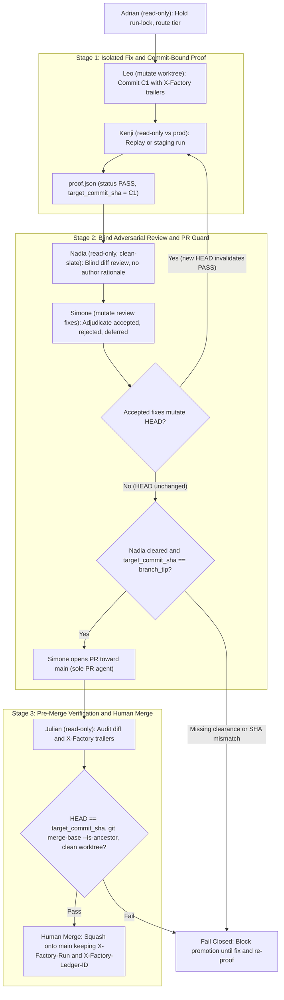
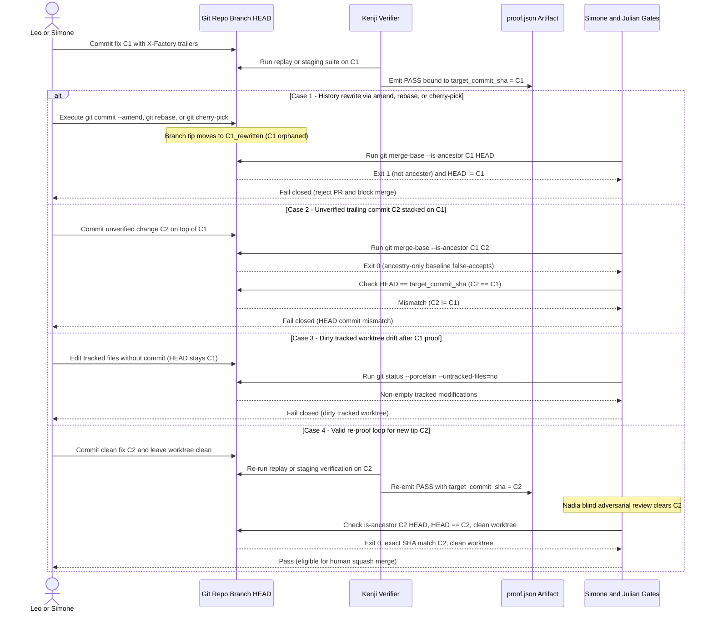
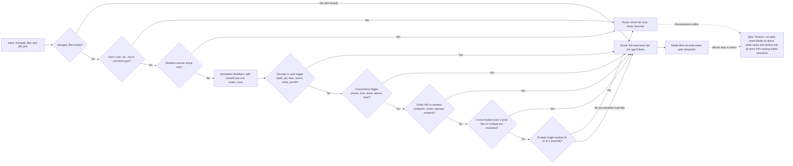

# Commit-Bound Proof Gates and Blind Adversarial Review in Autonomous QA Fleets

## Abstract

Autonomous software-engineering agents frequently emit test-pass summaries before opening pull requests, yet subsequent Git mutations or persuasive implementer explanations can decouple what was verified from what gets merged. In a public audit of `Koality-Assured/agent-factory` at commit `5106dd2db` and four public promotion repositories (`core-harness-wiki#8`, `ai-harness-core#21`, `harness-cli#36`, and `koality-image-find#3`–`#4`), verification rules were documented across skill contracts (`proof.json`, `target_commit_sha`, `git merge-base --is-ancestor`, and blind review), while automated Python enforcement and a formal `proof.json` schema were absent from the repository's scripts. Inspecting those contracts also uncovered two operational gaps: `validate-merge` relies on ancestry reachability alone (`git merge-base --is-ancestor`) without checking exact branch-tip equality, and two live PR summaries checked `--is-ancestor main HEAD` instead of `<target_commit_sha> HEAD`.

To measure the failure surface offline, we built a reproducible Python verification harness and evaluated three proof-gate designs across 31 ephemeral Git repositories in Python, Go, and JavaScript (10 iterations per scenario, 310 gate checks per arm). A naive status-only check (`status == "PASS"`, `exit_code == 0`) accepted 22 of 28 invalid states (`21.43%` fail-closed rate; `78.57%` false-accept rate; p50 `0.1692 ms`). An ancestry-only check (`git merge-base --is-ancestor`) raised fail-closed accuracy to `71.43%` (`74.19%` overall; p50 `81.6019 ms`) but failed open on `3/3` unverified trailing commits, `2/4` reset/detached-HEAD states, and `3/15` self-attestation or routing violations (`28.57%` false-accept rate). Enforcing exact `HEAD == target_commit_sha`, ancestry, clean tracked worktrees, distinct `author_id != reviewer_id`, cross-model tags, and negative-routing checks achieved `100.00%` accuracy (`100.00%` fail-closed, `0.00%` false-accept, `0.00%` false-reject; p50 `104.0581 ms`). On 16 labeled multi-language synthetic diffs, a CamelCase-normalized deterministic boundary classifier routed `100.00%` (`16/16`; p50 `0.0271 ms`) into `direct` versus `full-assurance` tiers without under-escalation, whereas file-count heuristics under-escalated `62.50%` (`5/8`) of security and concurrency diffs. Finally, controlled clean-slate trials on four single-file seeded-defect diffs using `Gemini 3.8 Flash (High)` yielded `4/4` `BLOCK` verdicts in both blind (`15` findings) and author-primed (`14` findings) arms (a `0.0%` binary verdict delta), showing that clean-slate isolation and explicit specifications resisted persuasive rationales in narrow diffs while leaving multi-file anchoring and cross-model effects unmeasured.

---

## 1. Thesis, Research Questions, Audience, and Structure

**Thesis.** Prompt-level verification instructions cannot stop post-proof branch drift or self-certification unless deterministic tooling binds proof receipts to exact Git commit objects, clean worktrees, and independent reviewer records. Ancestry checks alone close history rewrites (`--amend`, `rebase`, `cherry-pick`) yet admit unverified trailing commits stacked after verification; closing both requires `HEAD == target_commit_sha` alongside `git merge-base --is-ancestor`. Meanwhile, clean-slate diff-first review under `Gemini 3.8 Flash (High)` detected all four seeded defects even when persuasive author notes were present, showing that single-file experiments should not be extrapolated into unsupported claims about cross-model lift or large pull requests.

**Research questions.**

1. How often do naive status receipts and ancestry-only Git checks fail open under post-proof history rewrites, unverified trailing commits, detached `HEAD` states, dirty worktrees, and malformed or self-signed `proof.json` payloads?
2. What is the local verification latency and accuracy profile of a strict commit-bound gate (`HEAD == target_commit_sha` plus ancestry, cleanliness, and attestation checks) across Python, Go, and JavaScript repositories?
3. How accurately does deterministic path and identifier-normalized diff classification separate `direct` changes from `full-assurance` security, concurrency, schema, and cross-module changes without under-escalation?
4. When evaluating single-file seeded-defect pull requests in clean-slate subagents, does withholding persuasive author rationale (`blind`) change binary `BLOCK` detection or finding counts compared with author-primed (`non_blind`) review?

**Audience.** Platform engineers, security architects, and maintainers designing autonomous coding pipelines, CI promotion gates, or multi-agent QA orchestration harnesses.

---

## 2. Threat Model: Post-Verification Git Drift, Self-Certification, and Contract Gaps

### 2.1 Role Separation in `Koality-Assured/agent-factory`

At commit `5106dd2db` (PR #9, merged `2026-10-13T15:51:39Z`), `Koality-Assured/agent-factory` separates QA discovery from code mutation, verification, blind security review, pull-request creation, and human merging across 11 `AGENT.md` role specifications (`ai-tooling/agents/`) [S4].

| Role | Fleet | Isolation against target | Gate authority and restriction |
| :--- | :--- | :--- | :--- |
| `mara`, `elena`, `priya`, `owen`, `marcus` | QA | `read-only` | Discover problems, abuse vectors, and evidenced opportunities; every finding requires actionable reproduction steps (`finding.schema.json`). |
| `adrian` | Executive | `read-only` (ledger + `run-lock.json`) | Prioritizes `P0`–`P3`, selects `direct` vs `full-assurance` tier using `run-spec.md`, and enforces promotion order. |
| `julian` | Executive | `read-only` | Deconflicts file touch sets before `leo`; checks diff completeness, `git merge-base --is-ancestor`, and trailers after PR creation. Never implements or merges. |
| `leo` | Executive | `mutate` (isolated worktree) | Implements fixes and appends `Co-Authored-By`, `X-Factory-Run`, and `X-Factory-Ledger-ID` trailers. Never reviews, approves, or opens PRs. |
| `kenji` | Executive | `read-only` vs production | Executes `staging` or `local-replay` verification and writes `proof.json` bound to `target_commit_sha`. |
| `nadia` | Executive | `read-only` | Conducts blind adversarial review on raw diffs without author rationale; specifies promotion-safe controls. |
| `simone` | Executive | `mutate` (review fixes only) | Adjudicates findings (`accepted`/`rejected`/`deferred`), checks `target_commit_sha == branch_tip`, and is the only agent allowed to open a PR toward `main`. Never merges. |

This separation maps directly onto established governance and security controls [S8, S9, S10, S11]:

- **NIST AI RMF 1.0 (`NIST AI 100-1`):** `GOVERN 2.1` (documented role boundaries), `MEASURE 1.3` (assessments involving experts independent of front-line development), `MEASURE 2.5`–`2.8` (reliability, fail-safe containment, security, and transparency), and `MANAGE 1.1`/`2.4`/`4.1` (go/no-go promotion gates and change management) [S8].
- **OWASP 2026 & MITRE CWE:** `ASI08:2026` (Cascading Failures) and `LLM07:2026` (Misinformation, *Claim-Check-Act Patterns*) correspond to `CWE-367` (TOCTOU race condition between test execution and merge) and `CWE-354` (Improper Validation of Integrity Check Value). `LLM03:2026` (Excessive Agency) and `ASI03:2026` align with `CWE-250` (Execution with Unnecessary Privileges) and `CWE-862` (Missing Authorization). `ASI09:2026` (Human-Agent Trust Exploitation) captures persuasive agent explanations biasing human or downstream reviewers [S9, S10].
- **Agent2Agent (A2A) Protocol:** The A2A specification's Opaque Execution property allows agents to exchange declared task artifacts without sharing internal chain-of-thought or plans, providing the protocol foundation for blind diff review (`nadia`), reinforced by Section 13.1/13.4 authorization scoping and input validation [S11].

### 2.2 Public Contract Audit and Live PR Discrepancies

Inspecting `agent-factory` at `5106dd2db` and four public promotion repositories surfaced four concrete gaps between documented gate rules and automated execution [S4, S5, S6, S7].

First, `agent-factory` contains JSON Schemas and unit tests for `run-spec.schema.json` and `finding.schema.json` (`scripts/tests/test_schemas.py`: `2` tests passed in `0.007s`), yet has no `proof.schema.json` under `docs/standards/` and zero Python validation scripts referencing `proof.json`, `target_commit_sha`, or `is-ancestor` [S4]. All `proof.json` and Git ancestry rules live in Markdown skill instructions.

Second, exact branch-tip equality and ancestry reachability diverge across two executive skills. Simone's `review-and-pr/SKILL.md` requires `target_commit_sha` to equal the branch tip SHA and explicitly notes that applying accepted review fixes invalidates Kenji's proof until recomputed. Julian's `validate-merge/SKILL.md`, however, only specifies `git merge-base --is-ancestor <target_commit_sha> <branch_tip>` [S4]. While `--is-ancestor` catches `--amend`, `rebase`, and `cherry-pick` because those commands allocate unreachable commit SHAs [S1, S2], it exits `0` when an unverified commit is appended on top of `target_commit_sha`.

Third, `run-spec.md` (line 40) and `adrian/AGENT.md` (line 48) define the `direct` execution tier as `Leo -> Kenji -> Simone`, omitting Nadia. Yet `adrian/AGENT.md` (line 51), `executive-triage/SKILL.md` (line 41), `nadia/AGENT.md` (line 33), and `review-and-pr/SKILL.md` (line 49) prohibit skipping Nadia and require Simone to block PRs lacking Nadia's clearance [S4].

Fourth, auditing public promotion PRs revealed drift between written receipts and repository reality [S5, S6, S7]:

| Public repository | PR & merge UTC | PR head SHA | Squash commit on `main` | Observed verification receipts & gaps |
| :--- | :--- | :--- | :--- | :--- |
| `core-harness-wiki` | [`#8`](https://github.com/Koality-Assured/core-harness-wiki/pull/8) (`2026-10-14`) | `71fa6ff18` | `f7b1eeaa2` | `direct` tier; carries Kenji replay receipt (`node docs/scripts/invariants.test.mjs`, `3/3 passed`), target SHA, and 3 git trailers. Omits Nadia receipt and `proof.json` file [S5]. |
| `ai-harness-core` | [`#21`](https://github.com/Koality-Assured/ai-harness-core/pull/21) (`2026-10-27`) | `9fb4d1c8a` | `dc4fe30fe` | Carries trailers, target SHA, and pytest command; PR body logs `git merge-base --is-ancestor main HEAD` rather than `--is-ancestor 9fb4d1c8a HEAD` [S6]. |
| `harness-cli` | [`#36`](https://github.com/Koality-Assured/harness-cli/pull/36) (`2026-10-27`) | `87ef3932d` | `6a3b6ea07` | Carries trailers, target SHA, and `go test -count=1 ./... && go vet ./...`; PR body checks `--is-ancestor origin/main HEAD` rather than `--is-ancestor 87ef3932d HEAD` [S6]. |
| `koality-image-find` | [`#3`](https://github.com/Koality-Assured/koality-image-find/pull/3), [`#4`](https://github.com/Koality-Assured/koality-image-find/pull/4) (`2026-11-03`) | `c96cbd9c0`, `11a56711d` | `ca93cd591`, `ce362d7d7` | PR #3 links Kenji `proof.json` to `c96cbd9c0` with Nadia blind review; PR #4 merges `11a56711d` with trailers (`priya-02`) but omits `Target Commit SHA`, `proof.json`, and Nadia summary in the PR body [S7]. |

In all four repositories, GitHub squash merges minted new commit objects on `main` whose parents are the prior `main` tips rather than the PR head commits (`71fa6ff18`, `9fb4d1c8a`, `87ef3932d`, `c96cbd9c0`, `11a56711d`). Pre-merge verification (`HEAD == target_commit_sha` and `--is-ancestor`) must run against the PR branch ref before merge; post-merge provenance on `main` depends on PR history and the `X-Factory-Run` / `X-Factory-Ledger-ID` git trailers preserved in the squash commit message [S3].

---

## 3. Gate Architecture, Candidate Proof Schema, and Negative Routing

### 3.1 Multi-Stage Promotion Topology and Invalidation Loop

To enforce fail-closed promotion without relying on agent memory, the proposed architecture binds every verification receipt to immutable Git commit state and closes the re-proof loop whenever review fixes mutate the branch tip.



Figure 1 shows the complete promotion topology (source: [`01-promotion-gate-topology.mmd`](supporting/diagrams/01-promotion-gate-topology.mmd)). Any change introduced by Simone's accepted review fixes creates a new commit `C2`, routing control back to Kenji before PR creation. Figure 2 details how Git history mutations invalidate an existing proof receipt and how the strict gate handles trailing commits and dirty worktrees relative to an ancestry-only check (source: [`02-commit-invalidation-sequence.mmd`](supporting/diagrams/02-commit-invalidation-sequence.mmd)).



### 3.2 Candidate `proof.schema.json` and Strict Gate Invariants

We formalize the `proof.json` contract in [`supporting/proof.schema.json`](supporting/proof.schema.json) and implement enforcement in [`supporting/benchmark/proof_gate.py`](supporting/benchmark/proof_gate.py). Alongside the seven core `staging-prove` fields (`run_id`, `target_commit_sha`, `status`, `proof_mode`, `replay_command`, `exit_code`, `verified_at`), the candidate schema adds six attestation and routing fields (`author_id`, `reviewer_id`, `author_model_family`, `reviewer_model_family`, `tier`, `negative_route_checked`), plus conditional `staging_host` enforcement when `proof_mode == "staging"`.

`verify_strict_commit_bound` enforces ten invariants fail-closed:

1. **JSON object integrity:** Reject missing, unreadable, malformed, or non-object `proof.json` payloads.
2. **Exact verdict and exit-code type safety:** Require `status == "PASS"` and integer `exit_code == 0`, explicitly rejecting Python boolean values (`isinstance(False, int)` evaluates `True` in Python unless guarded).
3. **Canonical SHA-1 grammar and object type:** Require `target_commit_sha` to match `^[0-9a-f]{40}$` (rejecting short SHAs, uppercase, or symbolic refs such as `"HEAD"`), and verify `git cat-file -t <sha>` returns `"commit"`.
4. **Non-empty command and timezone-aware timestamp:** Require non-blank `replay_command` and timezone-aware ISO-8601 `verified_at` (plus non-blank `staging_host` when `proof_mode == "staging"`).
5. **Independent attestation:** Require non-empty `author_id` and `reviewer_id` with case-insensitive inequality (`author_id != reviewer_id`) to block self-certification.
6. **Cross-model diversity tag:** Require `author_model_family != reviewer_model_family` when `require_cross_model=True`.
7. **Explicit negative-routing audit:** Require `tier in {"direct", "full-assurance"}` and `negative_route_checked is True`.
8. **Git DAG reachability and exact branch-tip equality:** Require `git merge-base --is-ancestor <target_commit_sha> HEAD` exit `0` **and** `HEAD == target_commit_sha`.
9. **Branch-pointer integrity:** When `expected_branch` is declared, reject detached `HEAD` states (even when detached at `target_commit_sha`) and wrong branches.
10. **Clean tracked worktree:** Verify `git status --porcelain --untracked-files=no` is empty so post-proof tracked edits cannot escape review.

### 3.3 Deterministic Negative-Routing Boundary

To stop coordinators from defaulting every patch to an 11-agent pipeline (`always_full_assurance`) without creating unsafe blind spots on single-file security or concurrency changes, `classify_execution_tier` in `proof_gate.py` applies deterministic diff analysis (Figure 3, [`03-negative-routing-boundary.mmd`](supporting/diagrams/03-negative-routing-boundary.mmd)).



During early testing of `proof_gate.py`, plain word-boundary regex (`\bpermission\b`) missed Go CamelCase middleware identifiers (`RequirePermission`). Normalizing CamelCase, acronym transitions, and `snake_case` into space-separated sub-tokens before matching boundary keywords resolved that miss while keeping word boundaries intact so unrelated substrings (`author`, `block`) do not falsely trigger `auth` or `lock`.

---

## 4. Empirical Evaluation: Adversarial Git Matrix and Execution-Tier Routing

### 4.1 Experiment 1: Adversarial Git & Proof-Gate Matrix

We evaluated three verification arms offline on Windows 10 (`AMD64`, Python `3.11.9`, Git `2.49.0.windows.1`) across 31 deterministic ephemeral Git scenarios in Python, Go, and JavaScript (`3` valid scenarios and `28` negative mutation or tampering scenarios) [S12]:

- **Arm 1 (`naive_status_only`):** Checks JSON syntax, `status == "PASS"`, and non-boolean `exit_code == 0`.
- **Arm 2 (`ancestry_only`):** Validates core `staging-prove` fields, canonical 40-hex SHA syntax, `git cat-file -t == "commit"`, and `git merge-base --is-ancestor <target_commit_sha> HEAD`.
- **Arm 3 (`strict_commit_bound`):** Enforces all ten invariants in Section 3.2.

Each scenario ran for `10` measured iterations (`310` gate evaluations per arm), timing the verification function via `time.perf_counter()` after repository materialization. Table 1 summarizes the measured confusion matrix and latency distribution from [`summary.json`](supporting/benchmark/metrics/summary.json).

| Gate arm | TP | FP | TN | FN | Accuracy | Fail-closed rate | False-accept rate | Min (ms) | p50 (ms) | Mean (ms) | p95 (ms) | Max (ms) |
| :--- | :---: | :---: | :---: | :---: | :---: | :---: | :---: | :---: | :---: | :---: | :---: | :---: |
| `naive_status_only` | 3 | 22 | 6 | 0 | 29.03% | 21.43% | 78.57% | 0.0138 | 0.1692 | 0.2348 | 0.8606 | 1.8842 |
| `ancestry_only` | 3 | 8 | 20 | 0 | 74.19% | 71.43% | 28.57% | 0.0139 | 81.6019 | 72.1991 | 91.9437 | 197.5442 |
| `strict_commit_bound` | 3 | 0 | 28 | 0 | **100.00%** | **100.00%** | **0.00%** | 0.0141 | 104.0581 | 93.5301 | 115.5478 | 312.6763 |

Table 2 breaks down pass counts by scenario category from `summary.json` and [`matrix.csv`](supporting/benchmark/metrics/matrix.csv), isolating exactly why `ancestry_only` scored `28.57%` false accepts (`8/28` negative scenarios).

| Category | Total | Expected pass | `naive_status_only` passed | `ancestry_only` passed | `strict_commit_bound` passed |
| :--- | :---: | :---: | :---: | :---: | :---: |
| `clean_commit` (Python, Go, JS staging) | 3 | 3 | 3 | 3 | 3 |
| `amend` (Python, Go) | 2 | 0 | 2 | 0 | 0 |
| `rebase` (Python, JS) | 2 | 0 | 2 | 0 | 0 |
| `cherry_pick` (Go, Python) | 2 | 0 | 2 | 0 | 0 |
| `trailing_commit` (Python, Go, JS) | 3 | 0 | 3 | **3** | 0 |
| `reset_and_detached` | 4 | 0 | 4 | **2** | 0 |
| `tampered_proof` | 15 | 0 | 9 | **3** | 0 |

Three architectural conclusions emerge directly from Table 2:

1. **The trailing-commit bypass (`3/3` false accepts):** In Python, Go, and JavaScript repositories where an unverified commit was stacked on top of the verified commit `target_commit_sha`, `git merge-base --is-ancestor` exited `0`, passing `ancestry_only`. Only enforcing `HEAD == target_commit_sha` rejected all three (`strict_commit_bound`).
2. **Detached `HEAD` and dirty worktree blind spots (`2/4` false accepts):** `ancestry_only` accepted both a detached `HEAD` sitting directly on `target_commit_sha` (violating `expected_branch`) and a post-proof modification left uncommitted in tracked source files (`dirty_worktree_post_proof_javascript`). Checking symbolic ref parity and `git status --porcelain --untracked-files=no` closed both holes at a median incremental cost of `22.46 ms` (`104.0581 ms` vs `81.6019 ms` p50).
3. **Attestation and routing evasion (`3/15` false accepts):** `ancestry_only` validated only core `staging-prove` fields, so self-signed receipts (`author_id == reviewer_id`), identical model families, and `negative_route_checked: false` passed unless explicitly validated by the strict gate.

### 4.2 Experiment 2: Negative-Routing Tier Classification

We evaluated three tier classifiers across 16 synthetic multi-language diffs (`8` `direct` diffs matching `run-spec.md` negative-routing rules and `8` `full-assurance` diffs touching auth, leases/mutexes, path sanitization, HTTP endpoints, cross-module refactors, JSON Schemas, RBAC, and proof gates) over `10` iterations (`160` evaluations per classifier) [S12]. Table 3 reports the results from [`routing-metrics.json`](supporting/benchmark/metrics/routing-metrics.json).

| Classifier | Correct | Accuracy | Over-escalation (`direct` -> `full`) | Under-escalation (`full` -> `direct`) | p50 (ms) | Mean (ms) | p95 (ms) |
| :--- | :---: | :---: | :---: | :---: | :---: | :---: | :---: |
| `always_full_assurance` | 8/16 | 50.00% | 100.00% (8/8) | 0.00% (0/8) | 0.0005 | 0.0005 | 0.0006 |
| `naive_file_count` (`<= 1` file -> `direct`) | 7/16 | 43.75% | 50.00% (4/8) | 62.50% (5/8) | 0.0006 | 0.0006 | 0.0007 |
| `deterministic_boundary` | 16/16 | **100.00%** | **0.00% (0/8)** | **0.00% (0/8)** | 0.0271 | 0.0262 | 0.0425 |

The `naive_file_count` baseline demonstrates why file count is an unsafe proxy for risk: it over-escalated `4/8` two-file `direct` diffs (`3` code-plus-test bugfix pairs `direct_01`–`direct_03` and `1` two-file documentation typo edit `direct_04_docs_markdown_typo`) while dangerously under-escalating `5/8` single-file security, concurrency, and schema changes (`full_01` through `full_04`, plus `full_06`). Sub-tokenized boundary detection eliminated both failure modes in sub-millisecond time (`0.0271 ms` p50).

---

## 5. Controlled Blind vs. Author-Primed Review Trial

### 5.1 Multi-Language Seeded-Defect Fixtures

To test whether removing implementer self-justifications improves defect detection during gate review, we constructed four standalone multi-language pull-request fixtures in [`supporting/benchmark/blind-trials/`](supporting/benchmark/blind-trials/PROTOCOL.md), each pairing passing happy-path unit tests with one deterministic seeded defect:

1. **`trial_01_race_lease_go` (Go, `CWE-362`):** `Manager.Acquire` inspects lease expiry under `RLock()`, releases `RLock()` to call `m.hook`, and acquires `Lock()` without re-checking lease ownership. Running `go test -v ./...` passes `TestSingleOwnerSequential` while `TestReproConcurrentDoubleAcquire` fails (`expected 1 lease winner, got 2`).
2. **`trial_02_stale_sha_gate_py` (Python, `CWE-345`):** `verify_promotion_proof` validates `merge-base --is-ancestor` without exact `HEAD` matching or `^[0-9a-f]{40}$` grammar validation. Running `python -m unittest test_repro.py` passes `test_valid_proof_passes` while `test_repro_trailing_unverified_commit_bypasses_gate` fails (`AssertionError: True is not false`).
3. **`trial_03_path_boundary_js` (Node.js, `CWE-22`):** `resolveSafeExportPath` checks `!candidate.startsWith(root)` without a trailing `path.sep` check. Running `node --test exporter.test.mjs` passes the normal path test while `repro sibling-prefix directory escape bypasses startsWith check` fails on `../exports-secrets/token.txt`.
4. **`trial_04_silent_error_swallow_py` (Python, `CWE-636`):** `verify_artifact_digest` wraps JSON manifest parsing and lookup in `except Exception` and logs a warning while returning `True`. Running `python -m unittest test_repro.py` passes digest match/mismatch tests while `test_repro_corrupt_manifest_or_missing_entry_must_fail_closed` fails (`AssertionError: True is not false`).

### 5.2 Clean-Slate Subagent Results and Honest Null Verdict Delta

Paired review packets were dispatched to clean-slate `trial-reviewer` subagents running `Gemini 3.8 Flash (High)` (with `ground-truth-rubric.json` and failing reproducer tests strictly withheld). Arm B (`blind`) received only the specification and raw diff; Arm A (`non_blind`) received the identical specification and diff plus a confident author rationale explaining why the locking, `merge-base`, `startsWith`, or exception-fallback logic was safe and tested. Table 4 records the outcomes from [`blind-trial-results.json`](supporting/benchmark/metrics/blind-trial-results.json) [S13].

| Fixture | Arm B (`blind`) verdict & findings | Arm A (`non_blind`) verdict & findings | Seeded root cause caught (B / A) |
| :--- | :--- | :--- | :--- |
| `trial_01_race_lease_go` | `BLOCK` — 4 (`1` crit, `1` high, `2` med) | `BLOCK` — 3 (`1` crit, `1` high, `1` med) | Yes / Yes (Arm A missed same-owner/`ttl <= 0` edge) |
| `trial_02_stale_sha_gate_py` | `BLOCK` — 4 (`2` crit, `1` med, `1` low) | `BLOCK` — 4 (`2` crit, `2` med) | Yes / Yes |
| `trial_03_path_boundary_js` | `BLOCK` — 4 (`1` crit, `2` med, `1` low) | `BLOCK` — 4 (`1` crit, `1` high, `1` med, `1` low) | Yes / Yes |
| `trial_04_silent_error_swallow_py` | `BLOCK` — 3 (`1` crit, `2` med) | `BLOCK` — 3 (`1` crit, `2` med) | Yes / Yes |
| **Total** | **4/4 `BLOCK` (15 findings)** | **4/4 `BLOCK` (14 findings)** | **100.0% / 100.0% (`0.0%` delta)** |

**Interpretation.** On these four single-file synthetic diffs, clean-slate isolation paired with explicit per-trial invariant specifications produced a **0.0% binary verdict delta** (`4/4` `BLOCK` in both arms), with blind review surfacing one additional medium edge case (`15` vs `14` total findings). Under these controlled conditions, persuasive author prose did not trick a clean-slate `Gemini 3.8 Flash (High)` reviewer into approving any of the four single-file bugs. However, this trial does **not** isolate clean-slate isolation from rationale removal in long multi-turn threads, does not measure large multi-file diffs where author anchoring may carry greater weight, and did not evaluate a secondary model family (`Claude`).

---

## 6. Threats to Validity and Scope Boundaries

1. **Synthetic repository scale:** All 31 proof-gate tests ran in ephemeral single-package repositories (`setup_ms` ~332–574 ms). Large enterprise monorepos with deep Git histories, sparse checkouts, or slow storage will exhibit higher `git status` and `git merge-base` latencies.
2. **Single-host runtime measurements:** Latency percentiles (`104.0581 ms` p50, `115.5478 ms` p95 for `strict_commit_bound`) reflect Git `2.49.0.windows.1` subprocess spawning on Windows 10 (`AMD64`). Linux CI containers typically show lower process-creation overhead, which was not benchmarked across hosts here.
3. **Regex boundary routing limits:** `classify_execution_tier` operates on file paths and diff lines with CamelCase/snake_case sub-tokenization; it does not parse language ASTs or resolve cross-file call graphs, so obfuscated or indirect privilege boundaries in unfamiliar codebases could bypass keyword matching.
4. **Small trial sample and single model family:** The blind versus author-primed trial tested `N=4` single-file synthetic fixtures on `Gemini 3.8 Flash (High)`. Multi-file diffs, multi-turn inherited transcripts, and cross-model (`Claude` vs `Gemini`) comparisons remain unmeasured (`U1`).
5. **No live billing or token-savings measurement:** While `direct` routing avoids invoking the full 11-agent pipeline, end-to-end provider token bills and wall-clock savings between `direct` and `full-assurance` sweeps were not measured (`U2`).

---

## 7. Conclusion and Operator Guidelines

Written `SKILL.md` rules alone do not prevent stale verification receipts or ancestry loopholes. Across 31 offline scenarios, naive `PASS` checks failed open on `78.57%` of invalid states and `git merge-base --is-ancestor` failed open on `28.57%`, including every unverified trailing commit (`3/3`), detached `HEAD` tip mismatch, dirty worktree drift, and self-signed receipt. Enforcing exact `HEAD == target_commit_sha`, Git ancestry, worktree cleanliness, distinct `author_id != reviewer_id`, and negative-routing flags in deterministic Python closed all 28 negative scenarios (`100.00%` fail-closed rate, `0.00%` false-reject rate) at `104.0581 ms` p50 latency.

### Normative Operator Guidelines

1. **Enforce `proof.schema.json` and exact `HEAD` binding in CI/gate code:** Never rely solely on `git merge-base --is-ancestor` or prompt reminders; require `HEAD == target_commit_sha`, `^[0-9a-f]{40}$` commit syntax, non-boolean `exit_code == 0`, and `git status --porcelain --untracked-files=no` emptiness before PR creation and again before merge.
2. **Run proof gates against PR branch heads before squash merge:** Because GitHub squash merges mint new commits on `main`, validate commit-bound proofs on the PR head ref pre-merge and verify `X-Factory-Run` / `X-Factory-Ledger-ID` git trailers for post-merge traceability.
3. **Resolve the `direct`-tier Nadia spec conflict explicitly:** Either require Nadia's blind check on all code modifications or restrict `direct` tier strictly to pure documentation and lockfile-verified semver patches under deterministic path checks.
4. **Pair negative routing with identifier-normalized boundary checks:** Reject file-count heuristics (`<= 1` file -> `direct`), which under-escalated `62.50%` of security and concurrency fixtures; normalize CamelCase and `snake_case` tokens before screening security, concurrency, schema, and public-API boundaries.
5. **Keep reviewer context clean-slate and spec-anchored:** Dispatch adversarial reviewers with `fork_turns: "none"`, explicit invariant specs, and diff artifacts stripped of author chain-of-thought per A2A Opaque Execution; treat cross-model reviewer differences on multi-file diffs as open until empirically tested.

---

## 8. Reproducibility and Evidence Map

Every measurement in Sections 4 and 5 reproduces offline with Python 3.11+ and Git (`no` third-party `pip` packages or network access required). From `papers/AI-Engineering/commit-bound-proof-gates/`:

```bash
python supporting/benchmark/verify_sha256_manifest.py
python -m unittest discover -s supporting/benchmark -p "test_*.py" -v
python supporting/benchmark/run_benchmark.py --iterations 10 --out /tmp/proof-gate-repro
```

- **Supporting artifacts:** [`supporting/CLAIM-TO-EVIDENCE.md`](supporting/CLAIM-TO-EVIDENCE.md) (evidence classes `M1`–`M5`, `I1`–`I3`, `P1`–`P4`, `U1`–`U3`), [`supporting/SOURCES.md`](supporting/SOURCES.md) (`S1`–`S13`), [`supporting/REPRODUCIBILITY.md`](supporting/REPRODUCIBILITY.md), [`supporting/proof.schema.json`](supporting/proof.schema.json), and [`supporting/diagrams/README.md`](supporting/diagrams/README.md).
- **Companion practitioner post:** [Commit-Bound Proof Gates on ketron.dev](https://ketron.dev/blog/commit-bound-proof-gates) and [source post on GitHub](https://github.com/Koality-Assured/koality-blog/blob/main/posts/AI-Engineering/commit-bound-proof-gates/POST.md).
