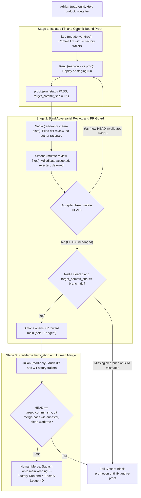
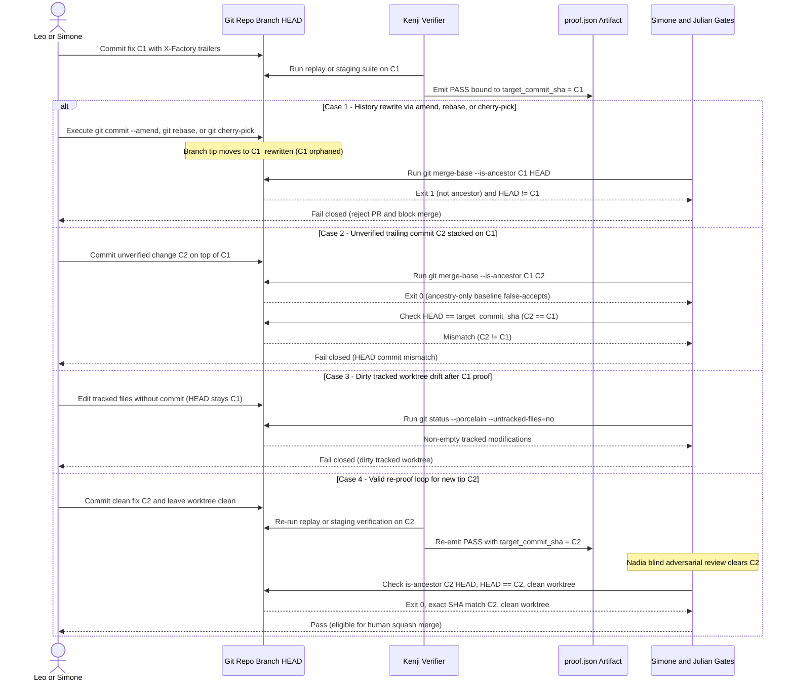
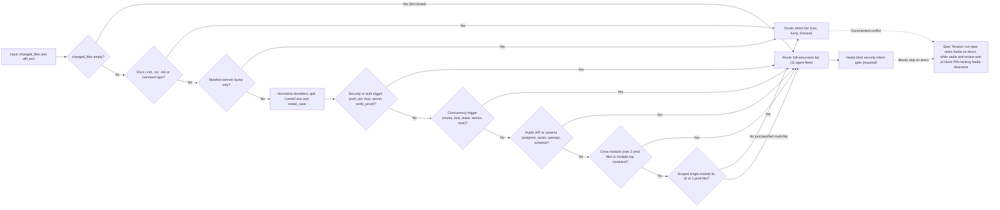

# Diagrams: Commit-Bound Proof Gates and Blind Adversarial Review

Canonical Mermaid sources for the whitepaper and blog pair on commit-bound proof gates in `Koality-Assured/agent-factory` (PR #9 contracts) and the offline verification suite in [`proof_gate.py`](../benchmark/proof_gate.py).

## Inventory

| File | Kind | Scope |
| --- | --- | --- |
| [`01-promotion-gate-topology.mmd`](./01-promotion-gate-topology.mmd) | `flowchart TD` | Multi-stage promotion pipeline from Leo fix through Kenji proof, Nadia blind review, Simone PR guard, Julian pre-merge check, and human squash merge. |
| [`02-commit-invalidation-sequence.mmd`](./02-commit-invalidation-sequence.mmd) | `sequenceDiagram` | Post-proof invalidation across `amend`, `rebase`, `cherry-pick`, trailing commits, and dirty worktrees versus a valid re-proof loop. |
| [`03-negative-routing-boundary.mmd`](./03-negative-routing-boundary.mmd) | `flowchart LR` | `direct` vs. `full-assurance` negative-routing boundary and the documented Nadia gate conflict on `direct` runs. |

## 1. Multi-stage promotion gate topology

Source: [`01-promotion-gate-topology.mmd`](./01-promotion-gate-topology.mmd). Shows separation of `mutate` and `read-only` authority, the re-proof loop when accepted review fixes advance `HEAD`, and trailer preservation across GitHub squash merges onto `main`.

## 2. Post-proof commit invalidation sequence

Source: [`02-commit-invalidation-sequence.mmd`](./02-commit-invalidation-sequence.mmd). Contrasts history rewrites (`--amend`, `rebase`, `cherry-pick`), unverified trailing commits (`HEAD != target_commit_sha` even when `git merge-base --is-ancestor` exits `0`), and dirty tracked worktree drift against a fresh re-proof on `C2`.

## 3. Negative-routing decision boundary

Source: [`03-negative-routing-boundary.mmd`](./03-negative-routing-boundary.mmd). Traces `classify_execution_tier` in [`proof_gate.py`](../benchmark/proof_gate.py): documentation and semver fast-paths route to `direct`, while CamelCase/snake_case normalized security, concurrency, public-API/schema, and cross-module triggers force `full-assurance`. Highlights the documented spec conflict where `run-spec.md` omits Nadia on `direct` runs while `nadia/AGENT.md` and `review-and-pr/SKILL.md` block PRs lacking Nadia clearance.

## Validation and rendering notes

- Every diagram uses Mermaid v10/v11 compatible syntax (`flowchart TD`, `sequenceDiagram`, `flowchart LR`), double-quoted labels for nodes and edges containing punctuation, `accTitle` / `accDescr` metadata, and no raw HTML ` ` tags.
- The three `.mmd` files are standalone Mermaid sources rendered inline by GitHub Markdown, requiring no external pre-compilation or build-host tooling.
