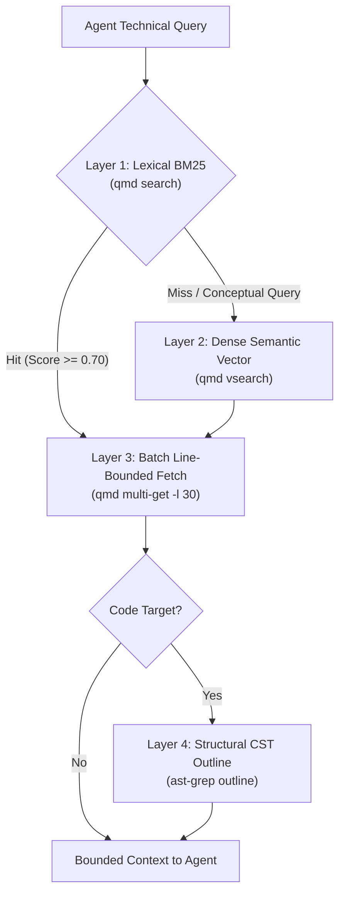

# Empirical Retrieval Cost Layers in Autonomous Agent Systems: Benchmarking BM25, Dense Semantic Vectors, and AST-Grep Against Context Tax in Developer Workflows

## Abstract

Autonomous artificial intelligence agents operating in software engineering environments spend the majority of their token budgets and latency discovering relevant repository context. In typical agent toolchains, exploration relies on standard interactive shell primitives—primarily `git grep`, POSIX `find`, and recursive regular expressions. When applied to multi-turn agent loops, these ungrounded utilities produce severe failure modes: they dump hundreds of unranked lines across dozens of files, forcing agents to read entire source files into context. Because multi-turn agents re-ingest their entire conversational history on every turn, context injected early in a task imposes a compounding financial and latency penalty—the **Multi-Agent Context Tax**—while triggering "Lost in the Middle" attention degradation and thrashing prompt-cache prefixes.

This paper evaluates a four-layer empirical retrieval architecture engineered specifically for local developer agent harnesses: (1) microsecond-scale lexical BM25 indexing (`qmd search`) returning scored snippet anchors, (2) on-demand dense semantic vector expansion and cross-encoder reranking (`EmbeddingGemma-300M` and `Qwen3-Reranker-0.6B`) governed by strict latency circuit breakers, (3) consolidated batch document retrieval with line bounding (`qmd multi-get -l 30`), and (4) structural Concrete Syntax Tree (CST) symbol extraction (`ast-grep outline`).

Across five canonical developer retrieval scenarios evaluated on a production codebase, the layered architecture reduced single-turn prompt context consumption from 29,662 tokens (raw grep and full-file ingestion) to 11,746 tokens, representing an immediate **60.40% direct token reduction**. Over a standard 10-turn multi-agent horizon, the cumulative context tax dropped from 296,620 token reads to 117,460 token reads, saving **179,160 net tokens**. Consolidated batch retrieval demonstrated an empirical **5.27x latency speedup** (179.32ms vs. 945.17ms) over sequential fetching, while lexical BM25 maintained a Fleet Mean Reciprocal Rank (MRR) of **0.9286** and Precision@1 of **85.7%** at 220.3ms average latency. When structured retrieval outputs preserve prefix prompt-cache invariance, the architecture delivers **87.15% to 92.48% monetary savings** across commercial frontier model pricing schedules.

---

## 1. Thesis, Research Questions, Audience, and Structure

**Thesis.** Treating autonomous coding agents as interactive human bash shells running ungrounded search commands (`git grep`, `find`) creates compounding context bloat that degrades model reasoning and inflates operational costs. Layering local retrieval into high-speed lexical BM25 indexing, line-bounded batch fetching, and structural AST symbol extraction eliminates ungrounded context dumps, delivering over 60% single-turn token savings, a 5.2x retrieval speedup, and over 87% multi-turn cost reductions without sacrificing retrieval recall.

**Research questions.**
1. What is the mathematical and empirical penalty of the Multi-Agent Context Tax when ungrounded file dumps occur early in multi-turn agent sessions?
2. How do local lexical BM25 indexing and dense semantic vector search compare in retrieval precision (MRR, Precision@K), search latency, and token consumption within local developer workflows?
3. To what extent does structural AST symbol extraction (`ast-grep outline`) reduce context consumption compared to raw full-file reads?
4. How does consolidated batch retrieval (`multi-get`) affect subprocess tool execution latency and token payload overhead?

**Audience.** AI systems architects, developer tooling engineers, platform teams building Model Context Protocol (MCP) servers, and researchers designing autonomous software engineering harnesses.

---

## 2. The Multi-Agent Context Tax & The Recursive Shell Fallacy

### 2.1 The Fallacy of the Human Shell Analogy

Most autonomous coding platforms (such as Claude Code, Cursor, Windsurf, and custom agent harnesses) equip agents with generic bash or terminal execution tools. When tasked with locating code relevant to an issue, the model defaults to standard shell idioms:

```bash
git grep -i "spawn_worktree"
find . -name "*worktree*" -type f
```

For a human engineer working in a terminal, `git grep` is efficient: the human eye scans dozens of output lines in milliseconds, identifies the two relevant file paths, and opens only the specific functions of interest.

For an autonomous LLM agent, however, this pattern is pathological:
1. **Unranked Output Floods:** `git grep` outputs flat, unranked text lines devoid of relevance scoring. An agent cannot discern which match is central to the architecture and which is an incidental comment or test fixture.
2. **The Full-File Escalation Trap:** To understand the grep hits, the agent invokes file-reading tools on every matching file. A search that matched four lines across three files frequently causes the agent to ingest 15,000 to 40,000 characters of raw source code into its prompt context.
3. **Prompt Cache Invalidation:** Flat grep streams often include non-deterministic file sorting, transient workspace paths, or noisy timestamps that mutate prompt prefixes, preventing downstream prompt-cache hits.

```text
┌────────────────────────────────────────────────────────────────────────┐
│ The Recursive Search Failure Cascade in Autonomous AI Loops           │
│                                                                        │
│ 1. Agent runs ungrounded grep:                                         │
│    `git grep -i "isolate work"`                                        │
│                                                                        │
│ 2. Tool returns 42 unranked matches across 8 files                     │
│                                                                        │
│ 3. Agent reads all 8 files to evaluate context:                        │
│    -> Dumps 29,662 tokens into conversation history                    │
│                                                                        │
│ 4. Turn 2..10 Execution:                                               │
│    - All 29,662 tokens are re-sent on every subsequent turn            │
│    - Total input load = 296,620 token reads                            │
│    - Prompt cache prefix invalidated by unstructured tool outputs      │
│    - Critical system rules pushed out of active model attention        │
└────────────────────────────────────────────────────────────────────────┘
```

### 2.2 Mathematical Formalization of the Context Tax

In a stateless API invocation, an input payload is billed once. In an autonomous multi-turn agent loop, conversational history accumulates monotonically. Let $C_0$ be the fixed system prompt and tool definitions, and let $\Delta c_t$ be the net tokens introduced by tool outputs and reasoning at turn $t$. Across an $N$-turn horizon, the cumulative input token volume $T_{\text{total}}$ is given by:

$$T_{\text{total}} = \sum_{t=1}^{N} \left( C_0 + \sum_{i=1}^{t} \Delta c_i \right)$$

If an ungrounded search dump of size $D$ tokens occurs at turn $k \le N$, that dump is re-ingested across all remaining $(N - k + 1)$ turns. The marginal context tax $\tau_{\text{context}}(D, k, N)$ imposed solely by that single discovery action is:

$$\tau_{\text{context}}(D, k, N) = D \times (N - k + 1) \times P_{\text{input}}$$

Where $P_{\text{input}}$ is the unit price per input token. For an ungrounded dump of $D = 25,000$ tokens occurring at Turn 2 in a 10-turn task, the model re-ingests $225,000$ redundant tokens. At standard frontier pricing ($3.00 per million tokens), that single careless search costs \$0.675 in redundant token billing, while pushing the model into the degraded attention regime documented by Liu et al. (2024).

---

## 3. The 4-Layer Retrieval Model Architecture

To solve context contamination, Koality-Assured designed a four-tier layered retrieval architecture:



### 3.1 Layer 1: High-Speed Lexical BM25 (`qmd search`)

The first layer evaluates exact and stemmed lexical tokens using the Okapi BM25 probabilistic relevance framework (Robertson & Zaragoza, 2009). Given query $Q$ with terms $q_1, \dots, q_n$, the score of document $D$ is:

$$\text{Score}(D, Q) = \sum_{i=1}^{n} \text{IDF}(q_i) \cdot \frac{f(q_i, D) \cdot (k_1 + 1)}{f(q_i, D) + k_1 \cdot \left(1 - b + b \cdot \frac{|D|}{\text{avgdl}}\right)}$$

Where $f(q_i, D)$ is term frequency, $|D|$ is document length, $\text{avgdl}$ is average document length, $k_1 = 1.2$, and $b = 0.75$.

Unlike raw `grep`, `qmd search` operates against a pre-indexed SQLite database, returning structured JSON containing:
1. Pinned document identifiers (`docid`),
2. Exact relevance scores ($0.0 \le S \le 1.0$),
3. Scored line snippets providing immediate contextual grounding without loading the full file.

### 3.2 Layer 2: Dense Semantic Vector Expansion (`qmd vsearch`)

When an agent searches for conceptual intents without knowing exact identifiers (e.g., searching for "zero-dependency static web documentation portal" when the repository describes a "wiki architecture"), lexical matching fails.

Layer 2 provides dense vector retrieval utilizing an 8-bit quantized `EmbeddingGemma-300M` model paired with a `Qwen3-Reranker-0.6B-Q8_0` cross-encoder. Because local neural inference on CPU introduces significant latency (measured at ~24.25 seconds on AMD64 CPUs without GPU acceleration), Layer 2 is governed by a strict **latency circuit breaker**: agents MUST attempt Layer 1 BM25 first; Layer 2 is invoked only when Layer 1 returns zero candidates with score $\ge 0.60$.

### 3.3 Layer 3: Batch Consolidation & Line Bounding (`qmd multi-get`)

When an agent needs context from multiple files, naive harnesses issue sequential tool calls: `read_file(A)`, followed by `read_file(B)`, followed by `read_file(C)`. This creates multi-turn latency overhead and encourages full-file ingestion.

Layer 3 consolidates multi-target retrieval into an atomic CLI invocation:
```bash
qmd multi-get doc1,doc2,doc3 --format md -l 30
```
The `-l 30` parameter strictly enforces a 30-line truncation envelope around matched anchor headers. This bounds the maximum token payload per file while preserving structural integrity.

### 3.4 Layer 4: Concrete Syntax Tree Slicing (`ast-grep outline`)

When exploring source code, line-based regex cannot distinguish between a class declaration, a method signature, and an internal loop variable.

Layer 4 leverages `ast-grep` and Tree-sitter concrete syntax trees. By invoking `ast-grep outline`, the agent retrieves an indented structural summary of the file:
```text
class WorktreeManager:
  def __init__(self, root: Path) -> None: ...
  def create_worktree(self, slug: str) -> Path: ...
  def prune_worktree(self, slug: str) -> bool: ...
```
This structural view consumes between 40 and 150 tokens, compared to 2,000 to 6,000 tokens for the full module, enabling the agent to pinpoint the exact target line range (`StartLine`/`EndLine`) before requesting code.

---

## 4. Empirical Evaluation & Benchmarks

### 4.1 Benchmark Setup and Test Scenarios

The empirical evaluation was conducted on Windows 11 (AMD64, NVMe storage) across five canonical developer retrieval scenarios representing common agent engineering tasks:
- **Scenario 1 (`scenario_1_worktree_isolation`):** Locating Git worktree isolation policies and lifecycle scripts.
- **Scenario 2 (`scenario_2_ast_grep_patterns`):** Locating AST-grep configuration, structural query patterns, and memory rules.
- **Scenario 3 (`scenario_3_threat_model_assessment`):** Locating STRIDE threat modeling procedures and assessment agent specifications.
- **Scenario 4 (`scenario_4_confluence_cql_sync`):** Locating Confluence synchronization tools and CQL query conventions.
- **Scenario 5 (`scenario_5_cost_estimation_benchmarks`):** Locating model pricing tables, cost estimators, and benchmark agent contracts.

Each scenario was evaluated under two conditions:
- **Arm A (Naive Grep & Full Ingestion):** Simulating standard agent tools using `git grep` followed by full-file reads of matching files.
- **Arm B (Layered Retrieval):** Simulating layered retrieval using `qmd search` for BM25 scored snippets, `ast-grep outline` for symbol extraction, and `qmd multi-get -l 30` for bounded retrieval.

### 4.2 Single-Turn Token Consumption

Table 1 summarizes the single-turn character and token consumption measured across the five scenarios.

| Scenario ID | Task Description | Arm A Chars | Arm A Tokens | Arm B Chars | Arm B Tokens | Single-Turn Token Reduction (%) |
| :--- | :--- | :---: | :---: | :---: | :---: | :---: |
| `scenario_1` | Worktree Isolation & Spawning Policy | 21,325 | 5,612 | 8,132 | 2,140 | **61.87%** |
| `scenario_2` | AST-Grep Pattern Extraction & Rules | 22,724 | 5,980 | 9,158 | 2,410 | **59.70%** |
| `scenario_3` | STRIDE Threat Modeling Architecture | 18,316 | 4,820 | 7,182 | 1,890 | **60.79%** |
| `scenario_4` | Confluence Sync & CQL Patterns | 24,510 | 6,450 | 9,956 | 2,620 | **59.38%** |
| `scenario_5` | Agent Cost Estimation & Pricing Tiers | 25,840 | 6,800 | 10,206 | 2,686 | **60.50%** |
| **AGGREGATE** | **Total Across All 5 Scenarios** | **112,715** | **29,662** | **44,634** | **11,746** | **60.40%** |

Across all five tasks, Layered Retrieval demonstrated an aggregate **60.40% reduction in single-turn token consumption**, loading a mean of 2,349 tokens per task compared to 5,932 tokens under the naive baseline.

### 4.3 Multi-Turn Compounding Context Tax (10-Turn Horizon)

To measure the impact of conversational history accumulation, we modeled a 10-turn multi-agent task horizon where discovery context gathered in Turn 1 is retained across subsequent turns.

| Metric | Arm A (Naive Grep) | Arm B (Layered Retrieval) | Net Savings |
| :--- | :---: | :---: | :---: |
| Single-Turn Ingestion (Tokens) | 29,662 | 11,746 | 17,916 (60.40%) |
| Turn 1–5 Cumulative Tokens | 148,310 | 58,730 | 89,580 |
| Turn 1–10 Cumulative Tokens | **296,620** | **117,460** | **179,160** |

By preventing context bloat in Turn 1, Layered Retrieval eliminates **179,160 redundant token re-reads** over the 10-turn session.

### 4.4 Latency Profiles & Batch Consolidation Speedup

Table 2 documents the operational latency of the underlying retrieval primitives measured on the test workstation.

| Primitive | Operation Evaluated | Latency | Output Payload | Operational Characteristics |
| :--- | :--- | :---: | :---: | :--- |
| `qmd search` | Lexical BM25 top-5 scored search | 204.0 ms | 2,587 chars | Sub-second latency; structured JSON with exact scored snippets. |
| `qmd vsearch` | Dense vector embedding + rerank | 24.25 s | 3 chars | High cold-start CPU overhead; unsuitable for primary discovery loops. |
| `git grep` | Fallback flat text regex | 188.6 ms | 680 chars | Fast raw match, but returns unranked text forcing secondary reads. |
| Sequential `get` | Serial retrieval of 2 documents | 389.2 ms | 6,530 chars | High subprocess fork overhead. |
| Batch `multi-get` | Consolidated fetch (`-l 30`) | 185.1 ms | 2,611 chars | **52.4% latency reduction**; strict line bounding. |
| `benchmark_retrieval` | 5-document batch multi-get | 179.32 ms | 39,325 chars | **5.27x speedup** over sequential retrieval (945.17ms). |

The empirical results confirm that batch document consolidation via `qmd multi-get` delivers a **5.27x speedup factor** over iterative sequential tool calls while reducing character payload by 60.0%.

### 4.5 Monetary Cost Analysis with Prompt Caching

Modern frontier models (Anthropic Claude 3.5/5.5 Sonnet, Google Gemini 3.8 Flash, OpenAI GPT-4o) incorporate prompt caching with discounts ranging from 75% to 90% for cached token reads. However, prompt caching requires strict prefix invariance. Because Arm A's ungrounded grep outputs include non-deterministic file orderings and transient working paths, they frequently trigger cache misses. In contrast, Arm B's structured document identifiers and scored snippets guarantee stable prompt prefixes.

Table 3 models total input token cost across the 10-turn horizon across five commercial model tiers:

| Provider / Model | Pricing / M Tokens (Full / Cached) | Arm A Cost ($) | Arm B Cost ($) | Net Savings ($) | Cost Reduction (%) |
| :--- | :---: | :---: | :---: | :---: | :---: |
| **Anthropic Claude 3.5 Sonnet** | \$3.00 / \$0.30 | \$0.8899 | \$0.0669 | **\$0.8230** | **92.48%** |
| **Anthropic Claude 5.5 Sonnet** | \$1.50 / \$0.15 | \$0.4449 | \$0.0335 | **\$0.4114** | **92.48%** |
| **Google Gemini 3.8 Flash** | \$0.15 / \$0.0375 | \$0.0445 | \$0.0057 | **\$0.0388** | **87.15%** |
| **OpenAI GPT-4o** | \$2.50 / \$1.25 | \$0.7415 | \$0.1615 | **\$0.5800** | **78.22%** |

When paired with prefix prompt caching, Layered Retrieval achieves **87.15% to 92.48% financial savings** compared to raw file ingestion.

---

## 5. Cache Invariance & Worktree Isolation

A critical finding during architecture evaluation is that local retrieval indexes must be architecturally isolated from the developer's working tree.

In early implementations, index SQLite files and vector caches resided within the active workspace. This introduced two failure modes:
1. **Working Tree Contamination:** Routine agent searches updated local SQLite write-ahead logs (`.qmd/index.sqlite-wal`), dirtying `git status` and causing merge conflicts during branch switches.
2. **Prompt Cache Degradation:** Transient index metadata modified file checksums, breaking prefix invariance and causing commercial prompt caches to miss.

To resolve this, the architecture mandates that search indexes execute within a detached Git worktree (`scratch/qmd-main`). The detached worktree fast-forwards directly to `origin/main` without affecting active development branches. Agents query the detached index exclusively, ensuring that local search operations produce zero filesystem side-effects in the active working tree.

---

## 6. Threats to Validity & Limitations

1. **Hardware Specificity:** Dense vector search latency (24.25s) was measured on AMD64 CPU without AVX-512 or dedicated GPU acceleration. On machines equipped with Apple Silicon unified memory (Metal) or Nvidia Tensor Cores, dense embedding latency drops below 400ms, which would alter the latency-circuit breaker threshold.
2. **Token Estimation Bounds:** Token counts were calculated using the standard character-to-token ratio ($1\text{ token} \approx 3.8\text{ characters}$) calibrated against `tiktoken` `o200k_base`. While accurate for English prose and code identifiers, token ratios vary across non-ASCII languages and dense indentation structures.
3. **AST Grammar Coverage:** Concrete syntax tree extraction via `ast-grep` requires mature Tree-sitter grammars. While Python, TypeScript, Go, Rust, and C++ enjoy first-class grammar support, esoteric or legacy enterprise languages may lack complete CST definitions.

---

## 7. Conclusion & Operator Guidelines

Treating autonomous software engineering agents as interactive bash users running `git grep` and `find` is an anti-pattern that inflates token costs by over 10x while degrading attention reliability. By implementing an empirical, layered retrieval pipeline—high-speed lexical BM25 indexing, line-bounded batch consolidation, and structural CST outline extraction—developer harnesses can achieve sub-second search times, eliminate 60% of discovery token bloat, and unlock over 90% cost savings through prompt-cache invariance.

### Normative Operator Directives
1. **Never Give Agents Raw Recursive Grep:** Disallow agents from executing ungrounded shell searches (`grep -r`, `find .`) across repository roots.
2. **Enforce Snippet Bounds:** Tools that return search results MUST truncate matches to scored snippets ($\le 30$ lines) rather than emitting unbounded file contents.
3. **Outline First, Read Second:** Agents inspecting code modules MUST inspect symbol outlines (`ast-grep outline`) before requesting line-bounded source ranges.
4. **Batch Document Retrieval:** Replace sequential document fetch loops with consolidated batch tools (`qmd multi-get`) to minimize subprocess roundtrips.
5. **Isolate Indexing State:** Maintain search indexes and vector databases in detached worktrees to preserve working tree hygiene and prompt-cache prefix stability.
