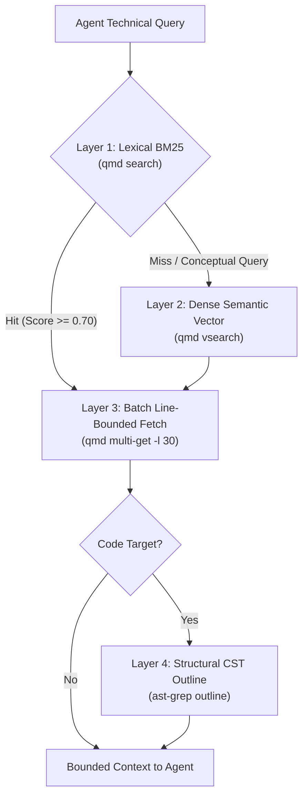

# Empirical Retrieval Cost Layers in Autonomous Agent Systems: Benchmarking BM25, Dense Semantic Vectors, and AST-Grep Against Context Tax in Developer Workflows

## Abstract

Autonomous software-engineering agents must discover relevant repository context. This paper studies a local developer-agent workload in which exploration uses standard shell primitives—primarily `git grep`, POSIX `find`, and recursive regular expressions. In the benchmark's naive arm, these utilities return unranked lines and lead to full-file reads, increasing the context retained by a multi-turn loop. In the modeled loop, retained context is re-read on later turns, creating a measurable token-volume penalty—the **Multi-Agent Context Tax**—while stable-prefix cache reuse remains provider- and API-dependent.

This paper evaluates a four-layer empirical retrieval architecture engineered specifically for local developer agent harnesses: (1) sub-second lexical BM25 indexing (`qmd search`) returning scored snippet anchors, (2) on-demand dense semantic vector expansion and cross-encoder reranking (`EmbeddingGemma-300M` and `Qwen3-Reranker-0.6B`) governed by strict latency circuit breakers, (3) consolidated batch document retrieval with line bounding (`qmd multi-get -l 30`), and (4) structural Concrete Syntax Tree (CST) symbol extraction (`ast-grep outline`).

Across five canonical developer retrieval scenarios evaluated on a production codebase, the ranked-and-bounded retrieval path reduced single-turn prompt context consumption from 29,662 tokens (raw grep and full-file ingestion) to 11,746 tokens, representing an immediate **60.40% direct token reduction**. Over a standard 10-turn multi-agent horizon, the cumulative context tax dropped from 296,620 token reads to 117,460 token reads, saving **179,160 net tokens**. The public QMD suite report measured batch retrieval at 0.1893 seconds versus 0.4006 seconds for two serial fetches, while the public multi-trial report measured fleet MRR of **0.9062**, Precision@1 of **81.2%**, and a p50 search latency of **187.77 ms**. This paper reports token volume and local retrieval measurements; it does not measure provider API cache hits or billed monetary savings.

---

## 1. Thesis, Research Questions, Audience, and Structure

**Thesis.** Treating autonomous coding agents as interactive human bash shells running ungrounded search commands (`git grep`, `find`) can create compounding context bloat in loops that retain prior turns. In the included five-scenario runner, lexical BM25 indexing plus line-bounded batch fetching reduced measured single-turn context volume by 60.40% in this workload; structural AST outline savings come from a separate cited report. The paper also reports local retrieval latency and ranking measurements; provider billing, cache-hit rates, and task-level accuracy remain outside scope.

**Research questions.**
1. What is the mathematical and empirical penalty of the Multi-Agent Context Tax when ungrounded file dumps occur early in multi-turn agent sessions?
2. How do local lexical BM25 indexing and dense semantic vector search compare in retrieval precision (MRR, Precision@K), search latency, and token consumption within local developer workflows?
3. To what extent does structural AST symbol extraction (`ast-grep outline`) reduce context consumption compared to raw full-file reads?
4. How does consolidated batch retrieval (`multi-get`) affect subprocess tool execution latency and token payload overhead?

**Audience.** AI systems architects, developer tooling engineers, platform teams building Model Context Protocol (MCP) servers, and researchers designing autonomous software engineering harnesses.

---

## 2. The Multi-Agent Context Tax & The Recursive Shell Fallacy

### 2.1 The Fallacy of the Human Shell Analogy

The benchmark models an autonomous coding agent with generic bash or terminal execution tools. When tasked with locating code relevant to an issue, the model defaults to standard shell idioms:

```bash
git grep -i "spawn_worktree"
find . -name "*worktree*" -type f
```

For a human engineer working in a terminal, `git grep` is efficient: the human eye scans dozens of output lines in milliseconds, identifies the two relevant file paths, and opens only the specific functions of interest.

For an autonomous LLM agent, however, this pattern is pathological:
1. **Unranked Output Floods:** `git grep` outputs flat, unranked text lines devoid of relevance scoring. An agent cannot discern which match is central to the architecture and which is an incidental comment or test fixture.
2. **The Full-File Escalation Trap:** To understand the grep hits, the agent invokes file-reading tools on every matching file. A search that matched four lines across three files frequently causes the agent to ingest 15,000 to 40,000 characters of raw source code into its prompt context.
3. **Prefix Stability Risk:** If a tool stream includes changing file order, workspace paths, or timestamps, it can change the prefix that a provider's caching API evaluates, reducing cache reuse.

```text
┌────────────────────────────────────────────────────────────────────────┐
│ The Recursive Search Failure Cascade in Autonomous AI Loops           │
│                                                                        │
│ 1. Agent runs ungrounded grep:                                         │
│    `git grep -i "isolate work"`                                        │
│                                                                        │
│ 2. Tool returns 42 unranked matches across 8 files                     │
│                                                                        │
│ 3. Agent reads all 8 files to evaluate context:                        │
│    -> Dumps 29,662 tokens into conversation history                    │
│                                                                        │
│ 4. Turn 2..10 Execution:                                               │
│    - All 29,662 tokens are re-sent on every subsequent turn            │
│    - Total input load = 296,620 token reads                            │
│    - Cache reuse depends on provider-specific prefix rules              │
│    - Critical system rules pushed out of active model attention        │
└────────────────────────────────────────────────────────────────────────┘
```

### 2.2 Mathematical Formalization of the Context Tax

In the modeled multi-turn agent loop, retained conversation context accumulates across requests. Let $C_0$ be the fixed system prompt and tool definitions, and let $\Delta c_t$ be the net tokens introduced by tool outputs and reasoning at turn $t$. Across an $N$-turn horizon, the cumulative input token volume $T_{\text{total}}$ is given by:

$$T_{\text{total}} = \sum_{t=1}^{N} \left( C_0 + \sum_{i=1}^{t} \Delta c_i \right)$$

If an ungrounded search dump of size $D$ tokens occurs at turn $k \le N$, that dump is re-ingested across all remaining $(N - k + 1)$ turns. The marginal retained-context volume $\tau_{\text{context}}(D, k, N)$ imposed solely by that single discovery action is:

$$\tau_{\text{context}}(D, k, N) = D \times (N - k + 1)$$

For an ungrounded dump of $D = 25,000$ tokens occurring at Turn 2 in a 10-turn task, the modeled loop re-reads $225,000$ redundant tokens. The dollar impact and any cache discount depend on the provider, model, API mode, cache controls, and observed cache hits; this paper does not estimate them.

---

## 3. The 4-Layer Retrieval Model Architecture

To solve context contamination, Koality-Assured designed a four-tier layered retrieval architecture:



### 3.1 Layer 1: High-Speed Lexical BM25 (`qmd search`)

The first layer evaluates exact and stemmed lexical tokens using the Okapi BM25 probabilistic relevance framework (Robertson & Zaragoza, 2009). Given query $Q$ with terms $q_1, \dots, q_n$, the score of document $D$ is:

$$\text{Score}(D, Q) = \sum_{i=1}^{n} \text{IDF}(q_i) \cdot \frac{f(q_i, D) \cdot (k_1 + 1)}{f(q_i, D) + k_1 \cdot \left(1 - b + b \cdot \frac{|D|}{\text{avgdl}}\right)}$$

Where $f(q_i, D)$ is term frequency, $|D|$ is document length, $\text{avgdl}$ is average document length, $k_1 = 1.2$, and $b = 0.75$.

Unlike raw `grep`, `qmd search` operates against a pre-indexed SQLite database, returning structured JSON containing:
1. Pinned document identifiers (`docid`),
2. Exact relevance scores ($0.0 \le S \le 1.0$),
3. Scored line snippets providing immediate contextual grounding without loading the full file.

### 3.2 Layer 2: Dense Semantic Vector Expansion (`qmd vsearch`)

When an agent searches for conceptual intents without knowing exact identifiers (e.g., searching for "zero-dependency static web documentation portal" when the repository describes a "wiki architecture"), lexical matching fails.

Layer 2 provides dense vector retrieval utilizing an 8-bit quantized `EmbeddingGemma-300M` model paired with a `Qwen3-Reranker-0.6B-Q8_0` cross-encoder. Because local neural inference on CPU introduced significant latency (10.293 seconds in the cited QMD suite run), Layer 2 is governed by a strict **latency circuit breaker**: agents MUST attempt Layer 1 BM25 first; Layer 2 is invoked only when Layer 1 returns zero candidates with score $\ge 0.60$.

### 3.3 Layer 3: Batch Consolidation & Line Bounding (`qmd multi-get`)

When an agent needs context from multiple files, naive harnesses issue sequential tool calls: `read_file(A)`, followed by `read_file(B)`, followed by `read_file(C)`. This creates multi-turn latency overhead and encourages full-file ingestion.

Layer 3 consolidates multi-target retrieval into an atomic CLI invocation:
```bash
qmd multi-get doc1,doc2,doc3 --format md -l 30
```
The `-l 30` parameter strictly enforces a 30-line truncation envelope around matched anchor headers. This bounds the maximum token payload per file while preserving structural integrity.

### 3.4 Layer 4: Concrete Syntax Tree Slicing (`ast-grep outline`)

When exploring source code, line-based regex cannot distinguish between a class declaration, a method signature, and an internal loop variable.

Layer 4 uses `ast-grep` and Tree-sitter concrete syntax trees. By invoking `ast-grep outline`, the agent retrieves an indented structural summary of the file:
```text
class WorktreeManager:
  def __init__(self, root: Path) -> None: ...
  def create_worktree(self, slug: str) -> Path: ...
  def prune_worktree(self, slug: str) -> bool: ...
```
This structural view consumes between 40 and 150 tokens, compared to 2,000 to 6,000 tokens for the full module, enabling the agent to pinpoint the exact target line range (`StartLine`/`EndLine`) before requesting code.

---

## 4. Empirical Evaluation & Benchmarks

### 4.1 Benchmark Setup and Test Scenarios

The canonical run was conducted on Windows 11 (AMD64, NVMe storage) with Python 3.11.9, QMD 2.8.3, and ast-grep 0.45.3. The benchmark runner uses a public `ai-router` checkout and the detached QMD index described in [REPRODUCIBILITY.md](supporting/REPRODUCIBILITY.md). It makes no external network calls during measurement.

The five scenarios use fixed query strings and fixed `sample_files` lists from the included runner. They represent common agent-engineering tasks:
- **Scenario 1 (`scenario_1_worktree_isolation`):** Locating Git worktree isolation policies and lifecycle scripts.
- **Scenario 2 (`scenario_2_ast_grep_patterns`):** Locating AST-grep configuration, structural query patterns, and memory rules.
- **Scenario 3 (`scenario_3_threat_model_assessment`):** Locating STRIDE threat modeling procedures and assessment agent specifications.
- **Scenario 4 (`scenario_4_confluence_cql_sync`):** Locating Confluence synchronization tools and CQL query conventions.
- **Scenario 5 (`scenario_5_cost_estimation_benchmarks`):** Locating model pricing tables, cost estimators, and benchmark agent contracts.

Each scenario was evaluated under two conditions:
- **Arm A (Naive Grep & Full Ingestion):** Runs `git grep -i` for the scenario query, then reads every existing file in that scenario's fixed sample list. Its payload is the grep output plus the full contents of those files.
- **Arm B (Scored and Bounded Retrieval):** Runs `qmd search --format json -n 5`, selects up to the three returned document identifiers, and fetches them with `qmd multi-get --format md -l 30`. Its payload is the search JSON plus the bounded multi-get response.

The included five-scenario runner does **not** invoke the `ast-grep` executable. AST outline savings are a separate measurement from the cited multi-trial report (S8), and the paper keeps that evidence distinct from the Arm A-versus-Arm B token comparison. This distinction matters: the aggregate token result supports the scored-and-bounded retrieval comparison, while the four-layer architecture describes the additional AST step used when the target is source code.

### 4.2 Single-Turn Token Consumption

The runner estimates tokens with `ceil(character_count / 3.8)`, using the ratio documented in the reproduction package. Arm A estimates grep output and full-file content separately; Arm B estimates search JSON and multi-get output separately. The character columns therefore show the measured payload components before the per-component token estimates are summed. They are not provider tokenizer counts.

Table 1 reports the per-scenario values in the included `trial-metrics.json`:

| Scenario ID | Task Description | Arm A Chars | Arm A Tokens | Arm B Chars | Arm B Tokens | Single-Turn Token Reduction (%) |
| :--- | :--- | :---: | :---: | :---: | :---: | :---: |
| `scenario_1` | Worktree Isolation & Spawning Policy | 61,243 | 16,118 | 8,947 | 2,356 | **85.38%** |
| `scenario_2` | AST-Grep Pattern Extraction & Rules | 14,452 | 3,804 | 11,166 | 2,940 | **22.71%** |
| `scenario_3` | STRIDE Threat Modeling Architecture | 17,028 | 4,482 | 7,394 | 1,946 | **56.58%** |
| `scenario_4` | Confluence Sync & CQL Patterns | 11,494 | 3,026 | 8,678 | 2,285 | **24.49%** |
| `scenario_5` | Agent Cost Estimation & Pricing Tiers | 8,479 | 2,232 | 8,430 | 2,219 | **0.58%** |
| **AGGREGATE** | **Total Across All 5 Scenarios** | **112,696** | **29,662** | **44,615** | **11,746** | **60.40%** |

Across all five tasks, Layered Retrieval demonstrated an aggregate **60.40% reduction in single-turn token consumption**, loading a mean of 2,349 tokens per task compared to 5,932 tokens under the naive baseline.

The per-scenario spread is part of the result, not noise to hide: the observed reduction ranges from **0.58%** in the cost-estimation scenario to **85.38%** in the worktree-isolation scenario. The aggregate is a weighted workload total, not a promise that every repository query will save 60%.

### 4.3 Multi-Turn Compounding Context Tax (10-Turn Horizon)

The included runner models conversational history rather than executing a live agent. For each scenario it sets `turns = 10` and computes:

$$T_{10}(s, a) = 10 \times T_1(s, a)$$

where $T_1(s, a)$ is the measured single-turn payload for scenario $s$ and arm $a$. The aggregate is the sum of the five scenario totals. This model treats the measured discovery payload as present in every turn, assumes no sliding-window truncation or provider-side compaction, and does not add new tool output after the initial comparison.

For example, Scenario 1 contributes $16,118 \times 10 = 161,180$ Arm A token reads and $2,356 \times 10 = 23,560$ Arm B token reads, a modeled difference of 137,620. This is a different accounting question from the single-dump example in Section 2: there, a dump introduced at Turn 2 is counted only across the remaining nine turns using $D \times (N-k+1)$. Neither model is a billing calculation.

| Metric | Arm A (Naive Grep) | Arm B (Layered Retrieval) | Net Savings |
| :--- | :---: | :---: | :---: |
| Single-Turn Ingestion (Tokens) | 29,662 | 11,746 | 17,916 (60.40%) |
| Turn 1–5 Cumulative Tokens | 148,310 | 58,730 | 89,580 |
| Turn 1–10 Cumulative Tokens | **296,620** | **117,460** | **179,160** |

The modeled difference is **179,160 cumulative input reads** across the five scenarios. It should be read as a retained-context volume comparison, not as 179,160 provider-billed tokens or as evidence that an agent completes the underlying tasks equally well.

### 4.4 Latency Profiles & Batch Consolidation Speedup

Table 2 documents the operational latency of the underlying retrieval primitives measured on the test workstation.

| Primitive | Operation Evaluated | Latency | Output Payload | Operational Characteristics |
| :--- | :--- | :---: | :---: | :--- |
| `qmd search` | Lexical BM25 top-5 scored search | 202.5 ms | 2,387 chars | Sub-second latency; structured JSON with exact scored snippets. |
| `qmd vsearch` | Dense vector embedding + rerank | 10.293 s | 2,769 chars | Higher cold-start CPU overhead; unsuitable for primary discovery loops in the cited run. |
| `git grep` | Fallback flat text regex | 43.1 ms | 295 chars | Fast raw match, but returns unranked text forcing secondary reads. |
| Sequential `get` | Serial retrieval of 2 documents | 400.6 ms | 6,530 chars | Two separate subprocess calls. |
| Batch `multi-get` | Consolidated fetch (`-l 30`) | 189.3 ms | 2,611 chars | **52.8% latency reduction**; strict line bounding. |

The cited QMD suite measured batch document consolidation at roughly **2.12x faster** than two serial `qmd get` calls while reducing the reported character payload by 60.0%. The comparison is a local workstation measurement, not a general latency guarantee.

The latency table also shows the trade-off behind the layering policy. In the cited run, raw `git grep` was faster than a ranked `qmd search` call (43.1ms versus 202.5ms), while dense vector search was much slower (10.293s). The architecture accepts the BM25 overhead to obtain scored, bounded retrieval and uses a circuit breaker before dense search; it does not claim that layered retrieval minimizes wall-clock time for every primitive or every workload.

### 4.5 Cost accounting and prompt-caching boundary

The benchmark measures local token volume and retrieval latency. It does not send requests to commercial model APIs, observe cache hits, or measure billed cost. A shorter, more stable prompt may improve cache reuse, but that outcome depends on the provider and API mode. For example, Anthropic documents opt-in `cache_control`, stable-prefix requirements, model-dependent minimum lengths, and cache-read usage fields; Google documents implicit caching with model-specific minimum input counts and cached-token telemetry; OpenAI documents model-dependent cacheable lengths and cached-token usage fields. See the current primary documentation in [SOURCES.md](supporting/SOURCES.md).

The earlier provider table is therefore intentionally omitted. The **60.40%** and **179,160-token** results are measured context-volume reductions in this workload, not universal dollar-savings estimates. A provider-specific cost study would need a fixed model and API, current prices, cache controls and TTLs, stable-prefix checks, and observed usage data for both arms.

---

## 5. Cache Invariance & Worktree Isolation

A critical finding during architecture evaluation is that local retrieval indexes must be architecturally isolated from the developer's working tree.

In early implementations, index SQLite files and vector caches resided within the active workspace. This introduced two failure modes:
1. **Working Tree Contamination:** Routine agent searches updated local SQLite write-ahead logs (`.qmd/index.sqlite-wal`), dirtying `git status` and causing merge conflicts during branch switches.
2. **Prefix Stability Risk:** If changing index metadata is emitted into tool output, it can alter a provider's cacheable prefix; this study did not measure that effect.

To resolve this, the architecture mandates that search indexes execute within a detached Git worktree (`scratch/qmd-main`). The detached worktree fast-forwards directly to `origin/main` without affecting active development branches. Agents query the detached index exclusively, ensuring that local search operations produce zero filesystem side-effects in the active working tree.

This is an operational hygiene invariant documented in the repository's QMD query pattern, not a measured outcome of the five-scenario token comparison. The benchmark runner resolves `scratch/qmd-main` when it is available; a reproduction that uses another index location should record that deviation because index freshness and corpus contents can change retrieval output.

---

## 6. Threats to Validity & Limitations

1. **Hardware Specificity:** Dense vector search latency (10.293s in the cited QMD suite run) was measured on AMD64 CPU without AVX-512 or dedicated GPU acceleration. Other hardware and acceleration paths may produce materially different latency and require separate measurement.
2. **Token Estimation Bounds:** Token counts were calculated using the standard character-to-token ratio ($1\text{ token} \approx 3.8\text{ characters}$) calibrated against `tiktoken` `o200k_base`. While accurate for English prose and code identifiers, token ratios vary across non-ASCII languages and dense indentation structures.
3. **AST Grammar Coverage:** Concrete syntax tree extraction via `ast-grep` requires mature Tree-sitter grammars. Language coverage and grammar quality vary, so results may not generalize to every repository.
4. **Provider Cost Boundary:** Provider billing, prompt-cache hit rates, and task-level accuracy were not measured. The reported benchmark does not establish a universal monetary or reasoning improvement.
5. **Fixed Workload Selection:** The five scenarios and their sample-file lists are hand-specified in the runner. They are useful public engineering tasks, but they are not a randomized sample of repositories or agent sessions.
6. **Arm Equivalence:** Arm A and Arm B compare captured retrieval payloads, not semantic answer quality. The runner does not check whether both arms expose the same relevant facts, and it does not invoke `ast-grep` in the Arm B script. AST savings are reported separately from S8.
7. **Timing Distribution:** The included runner records one timing observation per scenario. The QMD suite and multi-trial reports have their own measurement procedures, but none of these figures is a cross-host latency distribution for production traffic.
8. **Source Revision and Index State:** Reproduction requires a public source checkout and a matching local index. The package records tool versions and expected totals, but a rerun should record the exact source revision and index state alongside any new measurement.

---

## 7. Conclusion & Operator Guidelines

Treating autonomous software-engineering agents as interactive bash users running `git grep` and `find` can inflate retained context in multi-turn loops. In this workload, the ranked-and-bounded retrieval path—lexical BM25 indexing and line-bounded batch consolidation—reduced discovery context by 60.40% and kept the measured retrieval operations in the reported local latency range. Structural CST outline savings are separately reported, while provider cache behavior and monetary impact remain unmeasured.

### Normative Operator Directives
1. **Never Give Agents Raw Recursive Grep:** Disallow agents from executing ungrounded shell searches (`grep -r`, `find .`) across repository roots.
2. **Enforce Snippet Bounds:** Tools that return search results MUST truncate matches to scored snippets ($\le 30$ lines) rather than emitting unbounded file contents.
3. **Outline First, Read Second:** Agents inspecting code modules MUST inspect symbol outlines (`ast-grep outline`) before requesting line-bounded source ranges.
4. **Batch Document Retrieval:** Replace sequential document fetch loops with consolidated batch tools (`qmd multi-get`) to minimize subprocess roundtrips.
5. **Isolate Indexing State:** Maintain search indexes and vector databases in detached worktrees to preserve working tree hygiene. Treat any prompt-cache effect as provider-specific and verify it with usage telemetry.

---

## 8. Reproducibility and Evidence Map

The public package separates the five-scenario payload comparison from the cited retrieval-quality and AST fixture reports. To rerun the included comparison from a public `ai-router` checkout:

```bash
python supporting/benchmark/run_benchmark.py \
  --source-root /path/to/ai-router \
  --out /path/to/output
```

The expected aggregate is 29,662 versus 11,746 estimated single-turn tokens, a 60.40% reduction, and 179,160 fewer modeled cumulative input reads over the 10-turn horizon. The runner itself makes no external network calls. The reproduction guide records the Windows 11, Python, QMD, ast-grep, and Git environment used for the canonical run.

The evidence package links each result to its provenance: [CLAIM-TO-EVIDENCE.md](supporting/CLAIM-TO-EVIDENCE.md) labels measured results, primary-source facts, in-repo findings, inferences, and unresolved questions; [SOURCES.md](supporting/SOURCES.md) records the BM25 paper, POSIX and AST references, provider documentation, and retained QMD reports; and [REPRODUCIBILITY.md](supporting/REPRODUCIBILITY.md) supplies the commands and expected outputs. The unresolved items remain material: task-completion quality, cross-platform vector latency, and provider-specific monetary savings require separate experiments.

The practical implication is narrow but useful: start with scored lexical retrieval and bounded fetches, add AST outlines when the target is code, and instrument task success and provider telemetry before claiming quality or cost improvements. That sequence follows the measured local trade-offs without turning a context-volume result into an end-to-end agent-performance claim.
