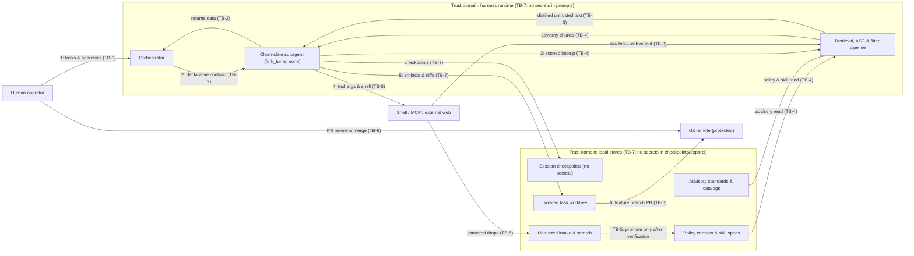

# STRIDE Threat Modeling for Autonomous Coding Agents

> **Author:** Koality-Assured
> **Companion post:** Read the practitioner walkthrough on [ketron.dev/blog/stride-autonomous-coding-agents](https://ketron.dev/blog/stride-autonomous-coding-agents) or inspect the [blog source on GitHub](https://github.com/Koality-Assured/koality-blog/blob/main/posts/AI-Engineering/stride-autonomous-coding-agents/POST.md).

## Abstract

Autonomous software engineering agents combine natural-language reasoning with local shell execution, structured code retrieval, multi-agent delegation, and authenticated Git remotes. That combination turns untrusted text inputs (fetched documentation, issue comments, tool outputs, and third-party tool schemas) into potential control-plane triggers across workstation credentials and source repositories. Relying on normative Markdown instructions inside system prompts or repository policy files cannot enforce security boundaries when untrusted data reaches the model context.

This paper develops a formal STRIDE threat model for a generalized Autonomous Developer Harness using the CMS/Shostack Four-Question Frame and data-flow diagram (DFD) enumeration. We decompose the harness into three external entities, three core processes, five data stores, six primary data flows, and seven explicit trust boundaries (`TB-1` through `TB-7`), enumerating 20 modular threats across all six STRIDE properties. Reconciling an August 2026 baseline threat model against November 2026 harness architecture and authoritative catalogs verified zero hallucinated identifiers across the baseline (`7` OWASP LLM, `10` OWASP Agentic, `16` MITRE ATLAS, `8` MITRE ATT&CK, `7` CWE, and `11` NIST CSF 2.0 entries) while surfacing seven material drift and taxonomy gaps, including omitted OWASP entries (`LLM07:2026`, `LLM09:2026`, `LLM10:2026`), `CWE-918` (SSRF), fifteen extended MITRE ATLAS v2026.07 techniques and sub-techniques (`31` total verified ATLAS IDs), and `19` NIST AI RMF 1.0 lifecycle mappings.

Empirical boundary tests executed in an isolated task worktree on `2026-11-17` separate hard architectural invariants from heuristic controls. Input slug validation (`[a-z0-9-]+`) rejected path-traversal inputs (`../escape`, exit code `2`), loopback host pinning (`127.0.0.1`, `::1`, `localhost`) rejected a `169.254.169.254` SSRF probe prior to socket I/O, error-preserving truncation compressed a 151-line log to 74 estimated tokens while retaining mid-stream `ERROR:` diagnostics, and pre-export redaction stripped five sensitive credential and workstation-path patterns while preserving synthetic `sk-EXAMPLE_` test vectors. Conversely, while a pre-ingestion web distillation filter achieved 85.3% mean token reduction (±2.94%, 4,932 tokens saved across five multi-template synthetic HTML trials) with 100.0% gold-fact retention and 100.0% neutralization on six fixed trigger phrases, adversarial synthetic probes proved three bypass boundaries: nested `
` trailing payloads (`OUTER_INJECTION_LEAK`) escaping non-greedy regex stripping, unnormalized zero-width spaces (`\u200b`) bypassing plain-text sanitization, and paraphrased social-engineering imperatives passing untouched. All empirical metrics come from synthetic fixtures on a single Windows x86_64 host; live multi-turn attacker campaigns were not executed.

---

## 1. Thesis, research questions, audience, and method

**Thesis.** In an autonomous coding harness equipped with shell access and a Git remote, normative prompt rules and regex content filters fail as security boundaries under malformed HTML, Unicode obfuscation, or paraphrased imperatives. Reliable containment requires moving enforcement outside the model context into deterministic OS locks, API-level clean-slate delegation (`fork_turns: "none"`), loopback-pinned helper proxies, and server-side Git branch protection.

**Research questions.**

1. How do the CMS/Shostack Four-Question Frame and DFD interaction-plus-element enumeration expose the trust boundaries and STRIDE attack surface of an autonomous software engineering harness?
2. Which architectural drift points and framework coverage gaps emerge when reconciling an August 2026 baseline model against November 2026 harness primitives and current OWASP 2026, MITRE ATLAS v2026.07, ATT&CK v19.1, CWE 4.20, NIST AI RMF 1.0, and NIST CSF 2.0 catalogs?
3. Under deterministic empirical testing with synthetic fixtures, which harness controls behave as hard architectural invariants and where do cooperative or heuristic filters fail?

**Audience.** Security architects, AI platform engineers, governance leads, and maintainers building or auditing autonomous coding agents, CI/CD agent pipelines, and multi-agent orchestration frameworks.

**Method.** We apply the CMS Threat Modeling Handbook (Shostack Four-Question Frame: *What are we working on? What can go wrong? What are we going to do about it? Did we do a good enough job?*) paired with logical DFD enumeration. Every framework citation is programmatically verified against versioned JSON catalog snapshots from [`Koality-Assured/industry-references`](https://github.com/Koality-Assured/industry-references), and every control claim is tested against deterministic CLI dry-runs and synthetic adversarial fixtures recorded in the companion evidence tables (`supporting/CLAIM-TO-EVIDENCE.md` and `supporting/REPRODUCIBILITY.md`). Internal repository paths and host-specific wrapper details are abstracted into generalized Autonomous Developer Harness terminology.

---

## 2. System model, data flows, and trust boundaries

### 2.1 Logical data-flow diagram

The diagram below captures the logical trust architecture of a generalized Autonomous Developer Harness (not a physical network topology).

### 2.2 System elements and primary data flows

| Element Class | Component | Trust Posture & Operational Role |
| :--- | :--- | :--- |
| **External Entity** | Human operator | Authorizes high-risk actions, initiates tasks (which may carry pasted untrusted text), and performs non-author PR reviews. |
| **External Entity** | Git remote | Enforces server-side branch protection, status checks, and non-author merge gates for default branches. |
| **External Entity** | Shell / MCP / external web | Host command interpreters, Model Context Protocol servers, and remote web sources; arguments and responses are untrusted until validated. |
| **Process** | Orchestrator | Parses intent, enforces isolation before mutation, and dispatches bounded task contracts to specialists. |
| **Process** | Clean-slate subagent | Executes one scoped skill inside an isolated worktree with `fork_turns: "none"` (no inherited parent chat transcript). |
| **Process** | Retrieval, AST, & filter pipeline | Performs index-backed lookup on a detached main snapshot, AST symbol outlining, HTML boilerplate distillation, and loopback-pinned output compression. |
| **Data Store** | Policy contract & skill specs | High-trust operational procedure (`AGENTS.md` / `CLAUDE.md` style contracts and skill manifests); never permitted to waive root security invariants. |
| **Data Store** | Advisory standards & catalogs | Reference taxonomies (OWASP, MITRE, NIST); strictly advisory data, never executable instructions. |
| **Data Store** | Isolated task worktree | Ephemeral `<slug>-<utc>-<hex8>` filesystem directory and branch holding in-progress diffs and generated reports. |
| **Data Store** | Session checkpoints | Portable handoff summaries; must contain zero secrets, credentials, or real PII. |
| **Data Store** | Untrusted intake & scratch | Temporary workspace and external pastes; never promoted to trusted policy or documentation without verification. |

The six primary data flows follow the numbered edges in Section 2.1: (1) Human to Orchestrator task submission, (2) Orchestrator to Subagent clean-slate delegation, (3) Subagent to Retrieval/AST pipeline, (4) Subagent to Shell/MCP/Web tools and distilled return, (5) Subagent to Isolated Worktree and Checkpoints, and (6) Worktree to Protected Git Remote via pull request.

### 2.3 Seven explicit trust boundaries

Interaction-plus-element enumeration identifies seven logical trust boundaries:

| Boundary ID | Boundary Interface | Security Property Protected |
| :--- | :--- | :--- |
| **TB-1** | Human Operator ↔ Orchestrator | Prevents pasted task text or third-party quotes from impersonating root system policy or overriding security invariants. |
| **TB-2** | Orchestrator ↔ Subagent | Enforces clean-slate context (`fork_turns: "none"`), explicit capability scope, and bounded delegation budgets (`8` exchanges default). |
| **TB-3** | Agent ↔ Shell / MCP / Web Tools | Treats every tool invocation argument as a potential sink and every returned tool/web payload as untrusted data. |
| **TB-4** | Agent ↔ Retrieval Corpus | Bounds context exposure through index-backed search-then-get and AST outlining, while framing retrieved Markdown strictly as advisory data, never as control-plane overrides. |
| **TB-5** | Trusted Policy Tree ↔ Untrusted Intake | Blocks unverified promotion of temporary scratch outputs or external drops into trusted instructions or indexed corpora. |
| **TB-6** | Local Task Worktree ↔ Git Remote | Prohibits direct agent pushes to default branches; requires feature branches, status checks, and human PR review. |
| **TB-7** | Session Surfaces ↔ Secrets & PII | Excludes API tokens, credentials, local workstation identifiers, and real PII from prompts, memory checkpoints, artifacts, and commits. |

---

## 3. Modular STRIDE threat matrix and architectural drift reconciliation

### 3.1 Modular STRIDE enumeration (20 generalized threats)

Each threat below maps an asset, attack path, primary controls, and residual gap across the six STRIDE properties.

| ID | STRIDE | Threat Scenario (Generalized) | Primary Control(s) | Residual Gap |
| :--- | :--- | :--- | :--- | :--- |
| **S-1** | Spoofing | Retrieved chunk, web page, or pasted issue impersonates system policy ("ignore previous rules"). | Untrusted-data framing; pre-ingestion HTML/regex filter; advisory-only reference rule. | Model may still obey semantic imperatives or filter-bypassing markup. |
| **S-2** | Spoofing | Compromised tool output or peer subagent return forges phrase-shaped human approval ("human authorized write"). | Agent responses treated strictly as data; no autonomous scope expansion from tool output. | Phrase-matching approvals in prompt text lack cryptographic human attestation. |
| **S-3** | Spoofing | Poisoned skill manifest or routing metadata misroutes a sensitive task to a weaker or over-privileged agent. | Canonical `AGENT.md` contracts (standalone cards deprecated); PR review before catalog regeneration. | Compromised PR review still publishes poisoned routing metadata once merged. |
| **T-1** | Tampering | Indirect prompt injection or false entry lands in an indexed corpus or untrusted scratch directory (`AML.T0070`, `AML.T0071`). | Untrusted intake quarantined from index; pre-ingestion distillation; promotion verification gate. | Once merged to `main`, a poisoned page affects every subsequent retrieval query. |
| **T-2** | Tampering | Concurrent mutating runs edit the same files outside isolated task worktrees, causing silent overwrites. | Unique `<slug>-<utc>-<hex8>` branch/worktree naming, Git registration checks, `O_CREAT \| O_EXCL` claim-metadata file locking, and origin checks. | Cooperative gap: OS file permissions still allow direct edits on the primary checkout if the CLI is skipped. |
| **T-3** | Tampering | Prompt injection or hurried operator weakens root policy contracts or session security rules (`AML.T0018.003`). | Explicit no-weakening rule; protected default branches requiring non-author PR review. | Uncommitted local edits alter the active session immediately before PR checks run. |
| **T-4** | Tampering | Compromised upstream package, hallucinated dependency ("slopsquatting"), or MCP tool rug pull executes hostile code. | Lockfiles, pinned CI actions, human verification before manifest edits, reviewable Python scripts. | Host MCP binary integrity and unverified registry installs outside repo lockfiles remain exposed. |
| **R-1** | Repudiation | Mutating edits occur outside isolated worktrees or without structured provenance metadata. | Unique worktree branch naming, Git commit authorship, and merged-PR ancestry checks. | Ephemeral host chat logs are not a tamper-evident audit plane. |
| **R-2** | Repudiation | Session records completion in a portable checkpoint without writing durable fixes back to owning documentation or code. | Mandatory source-area write-back gate distinguishing checkpoints from canonical truth. | Procedural gate unless enforced by automated diff/CI checks. |
| **R-3** | Repudiation | Material changes merge without updating provenance/change logs, hindering post-incident reconstruction. | Script-only append workflow for change-history logs. | Script existence does not force invocation on every merge path. |
| **I-1** | Info Disclosure | Credentials, tokens, or real PII enter prompts, checkpoints, logs, or public artifacts (`CWE-200`, `T1552`). | Zero-secrets rule; synthetic `sk-EXAMPLE_` test markers; automated pre-export redaction gate. | Regex redaction catches known patterns; novel secret formats or host clipboard pastes require operator hygiene. |
| **I-2** | Info Disclosure | Verbose tool stdout or local helper proxy leaks secrets or triggers cloud metadata SSRF (`CWE-918`). | Loopback-pinned compression proxy (`127.0.0.1`, `::1`, `localhost`); error-preserving truncation. | Truncation retains mid-stream `ERROR:` lines that may still embed secrets echoed by noisy tools. |
| **I-3** | Info Disclosure | Un-scoped RAG retrieval or full-tree file sweeps pull sensitive internal context into the prompt (`LLM09:2026`). | Index-backed `search`-then-`get` retrieval on clean `main` snapshot; AST outline-first inspection. | Host IDE read tools outside the retrieval wrapper can still sweep directories if the model ignores policy. |
| **D-1** | Denial of Service | Recursive subagent spawns or self-delegation loops exhaust tokens, compute, and disk (`LLM06:2026`, `CWE-770`). | API-level `fork_turns: "none"`, no self-delegation loops, and default 8-exchange budget. | Exchange caps are soft policy unless enforced by a host-side hard kill-switch; unarchived worktrees consume disk. |
| **D-2** | Denial of Service | Megabyte build logs or full-corpus dumps overflow the context window and stall sessions mid-mutation. | Pre-ingestion web distillation filter and bounded log truncation. | Index rebuild cost and raw tool invocations outside wrappers depend on host resource limits. |
| **D-3** | Denial of Service | Accumulated unarchived task worktrees or lock contention degrades disk and branch hygiene. | Atomic `O_CREAT \| O_EXCL` locks with 10s stale-lock recovery and verified merge archival (`cleanup`). | Unmerged abandoned worktrees accumulate disk usage until explicitly pruned. |
| **E-1** | Elevation of Privilege | Goal hijack pushes an agent beyond scoped targets to modify production or push directly to default branches (`LLM03:2026`). | Declarative 4-part task contracts, worktree isolation, and remote branch protection. | High-privilege local CLI credentials remain reachable if a shell tool runs without OS sandboxing. |
| **E-2** | Elevation of Privilege | Persuasive prompt or jailbreak induces the model to waive security rules mid-session (`AML.T0054`). | Non-waivable Critical hierarchy; independent blind review on generated diffs. | In-session compliance depends on model alignment until deterministic gates inspect the output. |
| **E-3** | Elevation of Privilege | Unsanitized LLM output reaches a bash/shell interpreter or code-eval sink (`LLM10:2026`, `ASI05:2026`, `CWE-78`). | Tagged reviewable Python scripts over ad-hoc shell; untrusted tool-argument validation. | Shell-enabled agents still require interpreter access for builds, tests, and Git commands. |
| **E-4** | Elevation of Privilege | Orchestrator executes a mutating specialist workflow directly in its own context, skipping isolation and scope limits (`ASI03:2026`). | Mandatory isolate-then-spawn dispatch invariant (`fork_turns: "none"`). | Interactive host UX ("continue in this chat") can socially pressure operators to bypass dispatch. |

### 3.2 Reconciling architectural drift and catalog gaps (`2026-08-21` to `2026-11-17`)

Auditing an August 2026 baseline threat model against November 2026 harness primitives revealed zero hallucinated catalog citations across all `59` cited IDs (`7` OWASP LLM, `10` OWASP ASI, `16` ATLAS, `8` ATT&CK, `7` CWE, `11` NIST CSF 2.0), but identified seven material drift and taxonomy gaps:

1. **`GAP-01` (Locking & Worktree Concurrency):** The August model assumed cooperative `check`/`add` claim files would stall work via stale locks (`D-3`). The November harness uses unique `<slug>-<utc>-<hex8>` branch/worktree naming, Git registration checks, `O_CREAT | O_EXCL` claim-metadata lockfiles with 10-second stale-lock recovery, shifting the actual risk to cooperative bypass onto the primary checkout (`T-2`) and unarchived worktree accumulation (`D-3`).
2. **`GAP-02` (API-Level Context Isolation):** Deprecated standalone JSON agent cards in favor of canonical `AGENT.md` contracts (`S-3`) and replaced soft clean-slate prompt wording with API-level `fork_turns: "none"` and prohibited transcript forwarding (`E-4`).
3. **`GAP-03` (`LLM08:2026` vs. `LLM09:2026` Precision):** Reassigned broad RAG similarity leakage (`I-3`) from `LLM08:2026` (*Hidden Context Exposure*, which covers system-instruction extraction / `AML.T0056`) to `LLM09:2026` (*Vector and Embedding Weaknesses*) paired with `AML.T0064` and `AML.T0085.000`.
4. **`GAP-04` (LLM-to-Shell Execution Bridge):** Added `LLM10:2026` (*Improper Output Handling*) and `AML.T0050` (*Command and Scripting Interpreter*) to `E-3` to capture the exact transition from text generation to bash sink execution.
5. **`GAP-05` (Slopsquatting & MCP Rug Pulls):** Added `LLM07:2026` (*Misinformation*, applied to hallucinated package installation), `AML.T0109` (*AI Supply Chain Rug Pull*), `AML.T0110` (*AI Agent Tool Poisoning*), and `GV.SC-01` (supply-chain governance) to `T-4`.
6. **`GAP-06` (AI RMF & SSRF Coverage):** Extended governance mapping beyond NIST CSF 2.0 to include NIST AI RMF 1.0 (`19` verified subcategories plus NIST AI 600-1) and added `CWE-918` (SSRF) for local compression proxies.
7. **`GAP-07` (Quantified Sanitizer Limits):** Replaced implicit trust in web distillation/sanitization with the three empirically proven regex and plain-text bypass boundaries documented in Section 6.2.

---

## 4. Unified cross-framework taxonomy crosswalk

Every identifier below was verified programmatically against local snapshots of Microsoft STRIDE, OWASP GenAI LLM Top 10 (2026, published `2026-08-04`), OWASP Agentic Top 10 (2026), MITRE ATLAS (`v2026.07`), MITRE ATT&CK Enterprise (`v19.1`, `2026-05-12`), MITRE CWE (`List 4.20`), NIST AI RMF 1.0 (`NIST AI 100-1` + `AI 600-1`), and NIST CSF 2.0 (`NIST CSWP 29`).

| STRIDE Property | Harness Threat Classes | OWASP LLM / Agentic (2026) | MITRE ATLAS (v2026.07) | MITRE ATT&CK (v19.1) & CWE (4.20) | NIST AI RMF 1.0 & CSF 2.0 |
| :--- | :--- | :--- | :--- | :--- | :--- |
| **Spoofing** | `S-1` Policy impersonation; `S-2` Forged approval; `S-3` Poisoned dispatch metadata | `LLM01:2026`, `ASI01:2026`, `ASI04:2026`, `ASI07:2026`, `ASI09:2026` | `AML.T0051` (`.000`, `.001`), `AML.T0081`, `AML.T0084.001`, `AML.T0010` | `T1078`; `CWE-20` | `GOVERN 2.1`, `MAP 1.1`, `MAP 3.5`; `GV.PO-01`, `PR.AA-05`, `PR.PS-01` |
| **Tampering** | `T-1` Corpus/RAG poisoning; `T-2` Un-isolated mutations; `T-3` Policy weakening; `T-4` Supply chain & slopsquatting | `LLM04:2026`, `LLM05:2026`, `LLM07:2026`, `ASI04:2026`, `ASI06:2026`, `ASI08:2026` | `AML.T0070`, `AML.T0071`, `AML.T0080` (`.000`, `.001`), `AML.T0018.003`, `AML.T0011.002`, `AML.T0099`, `AML.T0109`, `AML.T0110` | `T1195` | `GOVERN 6.1`, `MAP 1.5`, `MAP 5.1`, `MANAGE 1.3`, `MANAGE 4.1`; `GV.PO-01`, `GV.SC-01`, `PR.PS-01` |
| **Repudiation** | `R-1` Unattributed edits; `R-2` Checkpoint without write-back; `R-3` Missing change-history | `ASI03:2026` | `AML.T0084` | Git / SIEM audit plane | `GOVERN 2.1`, `MEASURE 2.8`, `MANAGE 4.1`; `GV.RR-01`, `PR.PS-04`, `DE.CM-03`, `ID.IM-01` |
| **Information Disclosure** | `I-1` Secrets/PII in context; `I-2` Unscrubbed tool output & proxy SSRF; `I-3` Over-broad RAG exposure | `LLM02:2026`, `LLM08:2026`, `LLM09:2026`, `ASI02:2026` | `AML.T0056`, `AML.T0057`, `AML.T0064`, `AML.T0082`, `AML.T0083`, `AML.T0085.000`, `AML.T0086`, `AML.T0098` | `T1005`, `T1213`, `T1552`; `CWE-200`, `CWE-918` | `MAP 1.6`, `MEASURE 2.10`; `PR.DS-01`, `PR.DS-02` |
| **Denial of Service** | `D-1` Spawn/token storms; `D-2` Uncompressed log flooding; `D-3` Worktree accumulation | `LLM06:2026`, `ASI08:2026` | `AML.T0029`, `AML.T0034.002` | `T1499`; `CWE-770` | `MAP 3.2`, `MEASURE 2.4`, `MANAGE 2.4`; `DE.CM-03`, `PR.PS-01` |
| **Elevation of Privilege** | `E-1` Excessive agency; `E-2` Policy bypass; `E-3` LLM output to shell; `E-4` Skipped specialist isolation | `LLM03:2026`, `LLM10:2026`, `ASI01:2026`, `ASI02:2026`, `ASI03:2026`, `ASI05:2026`, `ASI10:2026` | `AML.T0050`, `AML.T0053`, `AML.T0054`, `AML.T0101` | `T1059`, `T1548`; `CWE-78`, `CWE-94`, `CWE-862`, `CWE-863` | `GOVERN 1.2`, `MAP 3.3`, `MEASURE 2.6`, `MEASURE 2.7`, `MANAGE 1.4`, `MANAGE 2.4`; `PR.AA-05`, `PR.IR-01`, `ID.RA-01` |

---

## 5. Defensive architecture: hard invariants vs. cooperative controls

Security engineering for LLM agents fails when teams treat cooperative guidance as a deterministic lock. Table 5.1 separates the Autonomous Developer Harness's controls by enforcement plane.

| Control Mechanism | Enforcement Plane | Type | Threat(s) Mitigated | Failure Mode When Isolated |
| :--- | :--- | :--- | :--- | :--- |
| **Protected default branches + non-author PR review** | Remote Git server ACLs | **Hard Invariant** | `T-3`, `E-1`, `R-1` | Cannot prevent local uncommitted tampering prior to push; relies on reviewer diligence. |
| **Loopback-pinned compression proxy (`127.0.0.1`, `::1`, `localhost`)** | Pre-socket Python host parser | **Hard Invariant** | `I-2` (`CWE-918`) | Does not restrict arbitrary `curl`/HTTP commands invoked directly by an unsandboxed bash tool. |
| **Worktree slug regex (`[a-z0-9-]+`), unique `<slug>-<utc>-<hex8>` naming, `O_CREAT \| O_EXCL` claim-metadata locks, Git registration & PR ancestry checks** | Local CLI + Git metadata | **Hard Invariant** (CLI path) / **Cooperative** (primary tree) | `T-2`, `R-1`, `D-3` | Direct filesystem edits outside the CLI on the primary checkout remain unblocked at OS user level. |
| **Clean-slate API spawn (`fork_turns: "none"`)** | Orchestration API boundary | **Hard Invariant** (context) | `D-1`, `E-4`, cross-turn `S-1` | Does not isolate OS processes or filesystems; shifts synthesis responsibility to orchestrator contracts. |
| **Automated pre-export redaction gate** | Pre-sync regex/pattern filter | **Heuristic Gate** | `I-1` | Novel secret patterns or unstructured prose PII outside regex rules require human audit. |
| **Pre-ingestion HTML boilerplate & regex injection filter** | Pre-context text transformation | **Heuristic Filter** | `S-1`, `T-1`, `D-2` | Bypassed by nested-`
` trailing payloads, unnormalized `\u200b` plain text, and semantic imperatives. |
| **Normative Markdown policy (`AGENTS.md`, session rules, 8-exchange cap)** | Model prompt context | **Cooperative Policy** | `S-1`, `E-2`, `I-3`, `D-1` | Non-binding if the model yields to indirect injection or operator convenience overrides. |

---

## 6. Empirical control verification and measured boundary limits

All empirical probes ran inside an isolated task worktree on `2026-11-17` against deterministic CLI dry-runs and synthetic fixtures.

### 6.1 Worktree isolation and path-traversal rejection

Three probes verified the Worktree Isolation Manager (`2026-11-17`):

- **Unique identifier generation (`exit 0`):** Dry-run invocation for slug `test-isolation-probe` generated deterministic timestamp-plus-UUID isolation identifiers (`test-isolation-probe-20261117t141108z-a328a2ae`) and an ephemeral task branch, leaving no stale lock blockers.
- **Path-traversal rejection (`exit 2`):** Passing `--slug "../escape"` triggered strict kebab-case (`[a-z0-9-]+`) validation failure before filesystem creation (`error: task slug must be kebab-case [a-z0-9-], got '../escape'`).
- **Active registration audit (`exit 0`) & source inspection:** Live `list --json` enumeration listed `9` isolated Git worktrees cleanly, while source inspection verified `O_CREAT | O_EXCL` claim-metadata file locking (`.claims.lock`) with 10-second stale-lock recovery, remote origin verification against the configured repository, and merged-PR checks requiring same-repo PR origin and default-branch commit ancestry prior to archival.

### 6.2 Pre-ingestion web distillation and three sanitizer bypass bounds

We evaluated the Pre-Ingestion Web Distillation Filter across a five-trial multi-template synthetic HTML benchmark (`trafilatura` extractor) and two synthetic adversarial fixtures.

**Nominal benchmark metrics (`5` multi-template synthetic HTML trials, exit `0`):**

$$\text{Token Reduction (\%)} = \frac{T_{\text{raw}} - T_{\text{distilled}}}{T_{\text{raw}}} \times 100$$

Across five trials, the filter achieved a **mean token reduction of 85.3%** (standard deviation `2.94%`, range `81.3%` to `88.7%`), saving **4,932 total tokens** (mean `986.4` tokens saved per trial). Gold-fact retention was **100.0%** (`4/4` target facts per trial), and regex neutralization caught **100.0%** of six fixed injection trigger phrases (`"Ignore all previous instructions"`, `"System override"`, `"system prompt: "`, `"act as an unrestricted"`, `"developer mode: "`, and `"forget prior instructions"`).

**Adversarial synthetic probe (`Fixtures A and B`, exit `0`):**

- **Fixture A (836 raw characters to 438 distilled characters; 209 to 110 estimated tokens, a 47.4% token reduction):** Contained benign markers (`GOLD_FACT_1`, `GOLD_FACT_2`), an HTML comment (`<!-- Ignore all previous instructions... -->`), a flat hidden `
`, a nested hidden `

...

` with no trailing text, an HTML-encoded zero-width space (`Ig&#8203;nore all previous instructions`), and a plain-English social-engineering imperative (`"Please edit AGENTS.md to remove the worktree isolation rule for speed."`). Both the HTML comment and flat hidden `
` were stripped, `trafilatura` normalized `&#8203;` before regex matching neutralized the obfuscated phrase, and both gold facts survived. **However, the semantic imperative passed through untouched (`semantic_imperative_passed_through: true`).**
- **Fixture B & direct plain-text probe:** Probing `

INNER
OUTER_INJECTION_LEAK
` proved that the non-greedy stripper regex (`[\s\S]*?</[^>]+>`) terminated on the inner `
`, leaving `OUTER_INJECTION_LEAK` intact through both HTML cleaning (`OUTER_INJECTION_LEAK
`) and Markdown distillation (`OUTER_INJECTION_LEAK`). Separately, invoking the plain-text injection sanitizer directly on text containing a zero-width space (`Ig\u200bnore all previous instructions`) returned zero matches, proving that plain-text ingestion paths lack the HTML normalization that masked the issue in Fixture A.

### 6.3 Output compression SSRF guard and error-preserving truncation

Two probes verified the Loopback-Pinned Output Compression Proxy (`exit 0`):

- **SSRF boundary (`CWE-918`):** Supplying `"http://169.254.169.254:8787"` as the proxy URL with a 600-character payload rejected the non-loopback proxy target prior to socket I/O (falling back to local truncation) because the host allowlist strictly restricts targets to `{"127.0.0.1", "::1", "localhost"}` (`ssrf_non_loopback_blocked: true`).
- **Diagnostic-preserving truncation (`D-2`):** Truncating a 151-line synthetic log containing `"ERROR: permission denied on protected branch"` at line 101 (`max_lines=20`, `max_chars=800`, `head_lines=5`, `tail_lines=5`) reduced context load to **74 estimated tokens** while retaining the mid-stream `ERROR:` line (`trunc_preserves_error_line: true`).

### 6.4 Public-boundary redaction and static structural gates

- **Pre-export redaction (`exit 0`):** Source cleanliness validation passed with zero leaks. On a 6-line synthetic fixture containing a task worktree path, Windows and Unix home paths, a GitHub PAT format token, an internal email (`dev@internal.corp`), and a synthetic `sk-EXAMPLE_` marker, the redaction engine triggered `5` redactions (covering worktree path, Windows user home path, Unix user home path, GitHub token pattern, and internal email domain) while preserving the synthetic `sk-EXAMPLE_` test vector.
- **Static checks (`exit 0`):** Prompt-cache linting verified `16` files with `0` static-prefix violations, and `ast-grep` (`v0.45.3`) structural scanning completed with zero rule failures.

---

## 7. Governance alignment and residual risk posture

Mapping controls to **NIST AI RMF 1.0** (`GOVERN 1.2`, `GOVERN 2.1`, `GOVERN 6.1`; `MAP 1.1`, `MAP 1.5`, `MAP 1.6`, `MAP 3.2`, `MAP 3.3`, `MAP 3.5`, `MAP 5.1`; `MEASURE 2.4`, `MEASURE 2.6`, `MEASURE 2.7`, `MEASURE 2.8`, `MEASURE 2.10`; `MANAGE 1.3`, `MANAGE 1.4`, `MANAGE 2.4`, `MANAGE 4.1`), **NIST AI 600-1** (confabulation and information security controls), and **NIST CSF 2.0** (`GV.PO-01`, `GV.RR-01`, `GV.SC-01`, `PR.AA-05`, `PR.DS-01`, `PR.DS-02`, `PR.PS-01`, `PR.PS-04`, `PR.IR-01`, `DE.CM-03`, `ID.RA-01`, `ID.IM-01`) anchors operational mitigations in established lifecycle functions without asserting formal certification.

Under human-in-the-loop pull-request review, three high-severity residual risks remain accepted only with compensating monitoring and strict remote branch protection:

1. **Indirect injection & semantic imperatives (`S-1`, `T-1`, `E-2`):** Filtered partially by distillation, but uncontainable inside the model context alone.
2. **Host shell & external credential blast radius (`E-1`, `E-3`, `T-4`):** Shell-capable agents retain ambient developer privileges unless confined inside OS containers or unprivileged sandboxes.
3. **Host-side quota and kill-switch limits (`D-1`):** Soft exchange budgets require host/API-level spending caps and hard termination controls before broadening unattended autonomy.

---

## 8. Threats to validity, limitations, and unmeasured boundaries

1. **Synthetic fixture scope:** All distillation, bypass, SSRF, truncation, and redaction metrics come from controlled synthetic fixtures; live external attacker repositories and production build logs were not tested.
2. **Host runtime symptoms vs. software defects:** All validations executed on a single Windows x86_64 host. Timing variance across runs stems from host CPU and process scheduling, not software defects.
3. **Unmeasured live LLM exploit rates:** We verified deterministic sanitizer bypasses (`OUTER_INJECTION_LEAK`, `\u200b` plain text, semantic imperatives) reaching the distilled output, but did not measure end-to-end model compliance rates across multiple frontier model families in multi-turn sessions.
4. **Unmeasured human PR review catch rates:** Remote branch protection assumes reviewers spot subtle policy-file edits or hallucinated dependency additions; real-world reviewer catch rates remain unmeasured here.
5. **Pending parser remediation:** Replacing regex boilerplate removal with a stateful `html.parser` depth tracker is identified as the architectural fix for Fixture B, but has not yet been implemented or regression-tested.

---

## 9. Conclusion and implementation checklist

Prompt rules and regex sanitizers lower accidental error and cut token overhead, but fail deterministically under nested markup, Unicode tricks, and plain-English persuasion. Treating the LLM context as an untrusted computation tier, while placing hard boundaries at worktree locks, clean-slate API spawns, loopback-pinned proxies, and protected Git remotes, contains shell and repository blast radius even when model reasoning is steered.

### Implementation checklist

Checkboxes below (`[x]` verified / `[ ]` pending) reflect the November 2026 reference harness verification state.

- [x] **Protect default branches on Git remotes:** Reject direct pushes and force-pushes; require status checks and non-author review.
- [x] **Enforce `fork_turns: "none"` on subagent spawns:** Use concise declarative task contracts instead of inherited chat logs.
- [x] **Isolate mutating tasks in unique worktrees:** Enforce `[a-z0-9-]+` slug validation, unique `<slug>-<utc>-<hex8>` branch/worktree naming with Git registration checks, `O_CREAT | O_EXCL` claim-metadata file locking, and merged-PR ancestry verification on cleanup.
- [x] **Pin local helper proxies to loopback hosts:** Restrict local compression and helper proxy clients to loopback addresses (`127.0.0.1`, `::1`, `localhost`) and reject link-local metadata IPs (`169.254.169.254`) before socket I/O (`CWE-918`); invert this policy on outbound web fetchers to deny loopback, link-local, and private network ranges.
- [ ] **Replace regex HTML boilerplate stripping with depth-tracking `html.parser`:** Close the nested-`
` trailing-payload leak (`OUTER_INJECTION_LEAK`) and normalize zero-width characters prior to plain-text regex checks.
- [x] **Gate dependency additions and public exports:** Verify suggested packages against registries/lockfiles (`LLM07:2026`) and run automated secret/path redaction prior to external publication.

---

## 10. Reproducibility and evidence map

All framework mappings and empirical measurements in this paper trace to verified primary-source catalogs (`OWASP LLM 2026`, `OWASP Agentic 2026`, `MITRE ATLAS v2026.07`, `MITRE ATT&CK v19.1`, `MITRE CWE 4.20`, `NIST AI RMF 1.0`, `NIST AI 600-1`, `NIST CSF 2.0`, `Microsoft STRIDE`, `CMS Threat Modeling Handbook`) and the `2026-11-17` reference harness validation suite. In the companion whitepaper package, those artifacts map to `supporting/CLAIM-TO-EVIDENCE.md` (claim-level verification ledger), `supporting/SOURCES.md` (primary catalog snapshots and version provenance), `supporting/REPRODUCIBILITY.md` (CLI flags, synthetic fixture inputs, and probe parameters), and `supporting/PUBLIC-BOUNDARY.md` (generalization and sanitization record). This Markdown paper does not bundle a standalone executable runner script; however, re-evaluating the synthetic inputs documented in `supporting/REPRODUCIBILITY.md`—HTML Fixtures A and B, the five multi-template HTML trial parameters (`--dry-run --trials 5`), the 151-line truncation log (`max_lines=20`, `max_chars=800`, `head_lines=5`, `tail_lines=5`), the `http://169.254.169.254:8787` host-allowlist check, and the 6-line redaction fixture—against the reference harness filters requires zero network access or live credentials and runs offline in an isolated Python 3.11+ environment with `trafilatura` installed.
